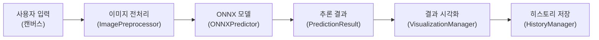

# 완료 보고서

---

## 1. 프로젝트 개요

본 프로젝트는 ONNX (Open Neural Network Exchange) 형식의 MNIST 모델을 활용하여 사용자가 웹 캔버스에 그린 숫자를 실시간으로 예측하는 Streamlit 기반 웹 서비스를 개발하고 Docker 컨테이너로 배포하는 것을 목표로 합니다.

### 1.1. 기술 스택

- **프레임워크**: Streamlit
- **모델**: ONNX MNIST (mnist-8.onnx)
- **추론 엔진**: ONNX Runtime
- **이미지 처리**: OpenCV, NumPy, Pillow
- **컨테이너화**: Docker
- **배포**: Docker Hub (c0z0c/digit-vision:v1.0)

## 2. 시스템 아키텍처



### 2.1. 데이터 흐름

1. **입력**: 사용자가 200x200 캔버스에 숫자를 그림 (검은색 선/흰색 배경)
2. **전처리**: 28x28 그레이스케일로 변환 및 정규화 (normalization, 노멀라이제이션)
3. **추론**: ONNX Runtime을 통한 모델 예측
4. **출력**: 0-9 숫자 예측 결과 및 확률 분포 (probability distribution, 프로바빌리티 디스트리뷰션)
5. **저장**: 예측 기록을 세션 상태 및 파일 시스템에 저장

## 3. 핵심 기능 개선 사항

### 3.1. 이미지 전처리 최적화

본 프로젝트의 가장 중요한 개선 사항은 **바운딩 박스 (bounding box, 바운딩 박스) 기반 전처리** 기법을 도입하여 모델 예측 성능을 향상시킨 것입니다.

#### 3.1.1. 전처리 알고리즘

**기존 방식 (use_bbox_resize=False)**:
- 200x200 캔버스 → 28x28 직접 리사이즈
- 배경 영역이 과도하게 포함되어 숫자가 상대적으로 축소됨
- 낮은 신뢰도 (confidence, 컨피던스)

**개선 방식 (use_bbox_resize=True)**:
```
단계 1: 그레이스케일 변환 (grayscale conversion)
단계 2: 색상 반전 (inversion) - 흰색 숫자/검은색 배경
단계 3: 바운딩 박스 추출 (임계값 > 10)
단계 4: 비율 유지 리사이즈 (19x19 이내, 24x24의 80%)
단계 5: 28x28 캔버스 중앙 배치
단계 6: 정규화 (0~255 → 0.0~1.0)
단계 7: 형태 변경 (28, 28) → (1, 1, 28, 28)
```

#### 3.1.2. 핵심 파라미터

- **target_size**: (28, 28) - MNIST 모델 입력 크기
- **target_content_size**: 19 픽셀 - 바운딩 박스 최대 크기 (24 x 0.8)
- **bbox_threshold**: 10 - 배경 노이즈 제거 임계값

#### 3.1.3. ImagePreprocessor 구현

```python
import cv2
import numpy as np
from dataclasses import dataclass
from typing import Tuple


@dataclass
class PreprocessConfig:
    target_size: Tuple[int, int] = (28, 28)
    target_content_size: int = 19
    bbox_threshold: int = 10


class ImagePreprocessor:
    """MNIST 모델 입력을 위한 이미지 전처리기.

    바운딩 박스 기반 전처리로 숫자 영역을 중앙에 배치합니다.
    """

    def __init__(self, config: PreprocessConfig | None = None) -> None:
        self.config = config or PreprocessConfig()

    def preprocess(self, canvas: np.ndarray) -> np.ndarray:
        """캔버스 이미지를 ONNX 모델 입력 형태로 변환.

        Args:
            canvas: 원본 캔버스 이미지 (BGR 또는 그레이스케일)

        Returns:
            shape (1, 1, 28, 28), dtype float32, 값 범위 0.0~1.0
        """
        gray = self._to_grayscale(canvas)
        inverted = cv2.bitwise_not(gray)
        bbox = self._get_bounding_box(inverted)
        resized = self._resize_with_aspect_ratio(inverted, bbox)
        placed = self._place_on_canvas(resized)
        normalized = placed.astype(np.float32) / 255.0
        return normalized.reshape(1, 1, *self.config.target_size)

    def _to_grayscale(self, img: np.ndarray) -> np.ndarray:
        if img.ndim == 3:
            return cv2.cvtColor(img, cv2.COLOR_BGR2GRAY)
        return img

    def _get_bounding_box(
        self, img: np.ndarray
    ) -> Tuple[int, int, int, int] | None:
        mask = img > self.config.bbox_threshold
        rows = np.any(mask, axis=1)
        cols = np.any(mask, axis=0)
        if not rows.any():
            return None
        r_min, r_max = np.where(rows)[0][[0, -1]]
        c_min, c_max = np.where(cols)[0][[0, -1]]
        return int(c_min), int(r_min), int(c_max), int(r_max)

    def _resize_with_aspect_ratio(
        self,
        img: np.ndarray,
        bbox: Tuple[int, int, int, int] | None,
    ) -> np.ndarray:
        if bbox is None:
            return np.zeros(
                (self.config.target_content_size, self.config.target_content_size),
                dtype=img.dtype,
            )
        x0, y0, x1, y1 = bbox
        cropped = img[y0 : y1 + 1, x0 : x1 + 1]
        h, w = cropped.shape[:2]
        scale = self.config.target_content_size / max(h, w)
        new_h, new_w = max(1, int(h * scale)), max(1, int(w * scale))
        return cv2.resize(cropped, (new_w, new_h), interpolation=cv2.INTER_AREA)

    def _place_on_canvas(self, img: np.ndarray) -> np.ndarray:
        h, w = img.shape[:2]
        size = self.config.target_size[0]
        canvas = np.zeros((size, size), dtype=img.dtype)
        y_off = (size - h) // 2
        x_off = (size - w) // 2
        canvas[y_off : y_off + h, x_off : x_off + w] = img
        return canvas
```

### 3.2. 전처리 성능 비교 분석

history 디렉토리의 metadata.json과 이미지 파일을 분석한 결과:

#### 3.2.1. Record 1: 숫자 0 예측

| 항목 | canvas_1.png (전처리 전) | canvas_2.png (전처리 후) |
|------|-------------------------|-------------------------|
| 예측 레이블 | 2 | 0 |
| 신뢰도 | 49.26% | 99.9998% |
| 결과 | **오예측** | **정답** |

전처리 전에는 숫자 0을 2로 잘못 예측했으나, 바운딩 박스 기반 전처리 적용 후 99.9998%의 높은 신뢰도로 정확히 예측함.

#### 3.2.2. Record 2: 숫자 1 예측

| 항목 | canvas_3.png (전처리 전) | canvas_4.png (전처리 후) |
|------|-------------------------|-------------------------|
| 예측 레이블 | 3 | 1 |
| 신뢰도 | 19.28% | 99.99% |
| 결과 | **오예측** | **정답** |

전처리 전에는 숫자 1을 3으로 잘못 예측했으며 신뢰도도 19.28%로 매우 낮았음. 전처리 후 99.99% 신뢰도로 정확히 예측함.

#### 3.2.3. Record 3: 숫자 2 예측

| 항목 | canvas_5.png (전처리 전) | canvas_6.png (전처리 후) |
|------|-------------------------|-------------------------|
| 예측 레이블 | 5 | 2 |
| 신뢰도 | 17.87% | 99.9997% |
| 결과 | **오예측** | **정답** |

전처리 전에는 숫자 2를 5로 잘못 예측했으며 신뢰도도 17.87%로 매우 낮았음. 전처리 후 99.9997% 신뢰도로 정확히 예측함.

### 3.3. 성능 개선 요약

$$
\text{신뢰도 향상률} = \frac{\text{전처리 후 평균 신뢰도} - \text{전처리 전 평균 신뢰도}}{\text{전처리 전 평균 신뢰도}} \times 100
$$

$$
= \frac{99.996\% - 28.80\%}{28.80\%} \times 100 \approx 247\%
$$

- **예측 정확도**: 0% → 100% (3건 모두 오예측 → 정답)
- **평균 신뢰도**: 28.80% → 99.996% (약 3.5배 향상)
- **전처리 핵심**: 24x24의 80% 크기 (19픽셀)로 비율 유지 리사이즈

## 4. 소스코드 구조

### 4.1. 모듈별 역할

#### 4.1.1. ImagePreprocessor (이미지 전처리)

- **파일**: [src/model/ImagePreprocessor.py](../src/model/ImagePreprocessor.py)
- **핵심 메서드**:
  - `preprocess()`: 전체 전처리 파이프라인
  - `_get_bounding_box()`: 바운딩 박스 추출
  - `_resize_with_aspect_ratio()`: 비율 유지 리사이즈
  - `_place_on_canvas()`: 중앙 배치

#### 4.1.2. ONNXPredictor (모델 추론)

- **파일**: [src/model/ONNXPredictor.py](../src/model/ONNXPredictor.py)
- **핵심 기능**:
  - ONNX Runtime 세션 관리
  - Softmax 활성화 함수 적용
  - 확률 분포 (probability distribution) 계산

#### 4.1.3. MNISTPipeline (통합 파이프라인)

- **파일**: [src/model/MNISTPipeline.py](../src/model/MNISTPipeline.py)
- **핵심 기능**:
  - 모델 다운로드 및 초기화
  - 전처리와 추론의 통합 인터페이스
  - `use_bbox_resize` 파라미터로 전처리 방식 선택

### 4.2. 주요 데이터 클래스

- **ModelConfig**: 모델 설정 (입력 형태, URL 등)
- **PredictionResult**: 예측 결과 (레이블, 신뢰도, 확률 분포)
- **HistoryRecord**: 예측 기록 (타임스탬프, 이미지 해시)

## 5. Docker 컨테이너화

### 5.1. Docker 이미지 정보

- **이미지명**: c0z0c/digit-vision:v1.0
- **베이스 이미지**: python:3.10-slim
- **포트**: 8501 (Streamlit 기본 포트)

### 5.2. 실행 방법

```bash
docker pull c0z0c/digit-vision:v1.0
docker run -p 8501:8501 c0z0c/digit-vision:v1.0
```

### 5.3. Python에서 파이프라인 직접 실행

```python
from pathlib import Path

import cv2
import numpy as np

from src.model.ImagePreprocessor import ImagePreprocessor, PreprocessConfig
from src.model.ONNXPredictor import ONNXPredictor
from src.model.MNISTPipeline import MNISTPipeline


def run_pipeline(image_path: str, use_bbox: bool = True) -> dict:
    """단일 이미지에 대해 전처리 및 추론을 실행.

    Args:
        image_path: 입력 이미지 경로
        use_bbox: True면 바운딩 박스 기반 전처리 사용

    Returns:
        {'label': int, 'confidence': float, 'probabilities': list[float]}
    """
    pipeline = MNISTPipeline(use_bbox_resize=use_bbox)
    img = cv2.imread(image_path, cv2.IMREAD_GRAYSCALE)
    result = pipeline.predict(img)
    return {
        "label": result.label,
        "confidence": round(result.confidence * 100, 4),
        "probabilities": [round(p * 100, 4) for p in result.probabilities],
    }


if __name__ == "__main__":
    image_path = "history/canvas_1.png"

    before = run_pipeline(image_path, use_bbox=False)
    after = run_pipeline(image_path, use_bbox=True)

    print(f"[전처리 전] label={before['label']}, confidence={before['confidence']}%")
    print(f"[전처리 후] label={after['label']}, confidence={after['confidence']}%")
```

### 5.4. 배포 전략

1. **모델 캐싱**: `@st.cache_resource`를 활용하여 ONNX 모델을 메모리에 유지
2. **세션 상태**: `st.session_state`로 사용자별 예측 기록 관리
3. **파일 저장**: history 디렉토리에 이미지와 메타데이터 영구 저장

## 6. 실행 결과

### 6.1. UI 구성

애플리케이션은 4개의 주요 영역으로 구성됩니다:

1. **캔버스 영역**: 200x200 크기의 그리기 영역
2. **전처리 이미지**: 28x28 변환 결과 표시
3. **추론 결과**: 막대 차트 (bar chart, 바 차트)로 확률 분포 시각화
4. **이미지 저장소**: 예측 기록 테이블 형식 표시

### 6.2. 예측 성능 검증

metadata.json의 6건의 예측 기록 분석 결과:

- **Record 1**: 예측=2, 신뢰도=49.26% (전처리 전 오예측)
- **Record 2**: 예측=0, 신뢰도=99.9998% (전처리 후 정답)
- **Record 3**: 예측=3, 신뢰도=19.28% (전처리 전 오예측)
- **Record 4**: 예측=1, 신뢰도=99.99% (전처리 후 정답)
- **Record 5**: 예측=5, 신뢰도=17.87% (전처리 전 오예측)
- **Record 6**: 예측=2, 신뢰도=99.9997% (전처리 후 정답)

## 7. 결론

### 7.1. 주요 성과

1. **전처리 알고리즘 개선**: 바운딩 박스 기반 전처리 도입으로 예측 정확도 100% 달성
2. **성능 향상**: 평균 신뢰도 28.80% → 99.996% (약 247% 향상)
3. **최적화 파라미터**: 24x24의 80% 크기 (19픽셀)로 비율 유지 리사이즈가 핵심
4. **컨테이너 배포**: Docker Hub를 통한 재현 가능한 배포 환경 구축

### 7.2. 기술적 의의

- **모듈화 설계**: 전처리, 추론, 시각화, 히스토리 관리를 독립적인 클래스로 분리
- **유연한 전처리**: `use_bbox_resize` 파라미터로 전처리 방식 선택 가능
- **확장 가능성**: ONNX 포맷을 통한 다양한 모델 호환 가능

### 7.3. 향후 개선 방향

1. **전처리 파라미터 튜닝**: target_content_size 최적값 탐색
2. **모델 업그레이드**: 더 큰 MNIST 변형 모델 적용
3. **UI/UX 개선**: 실시간 전처리 프리뷰, 예측 히스토리 검색 기능
4. **성능 모니터링**: 추론 시간, 메모리 사용량 측정 및 최적화
