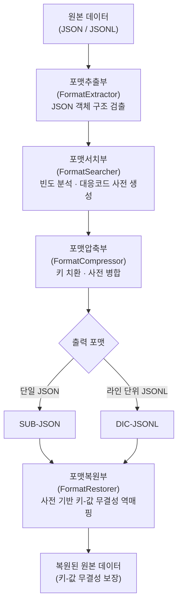
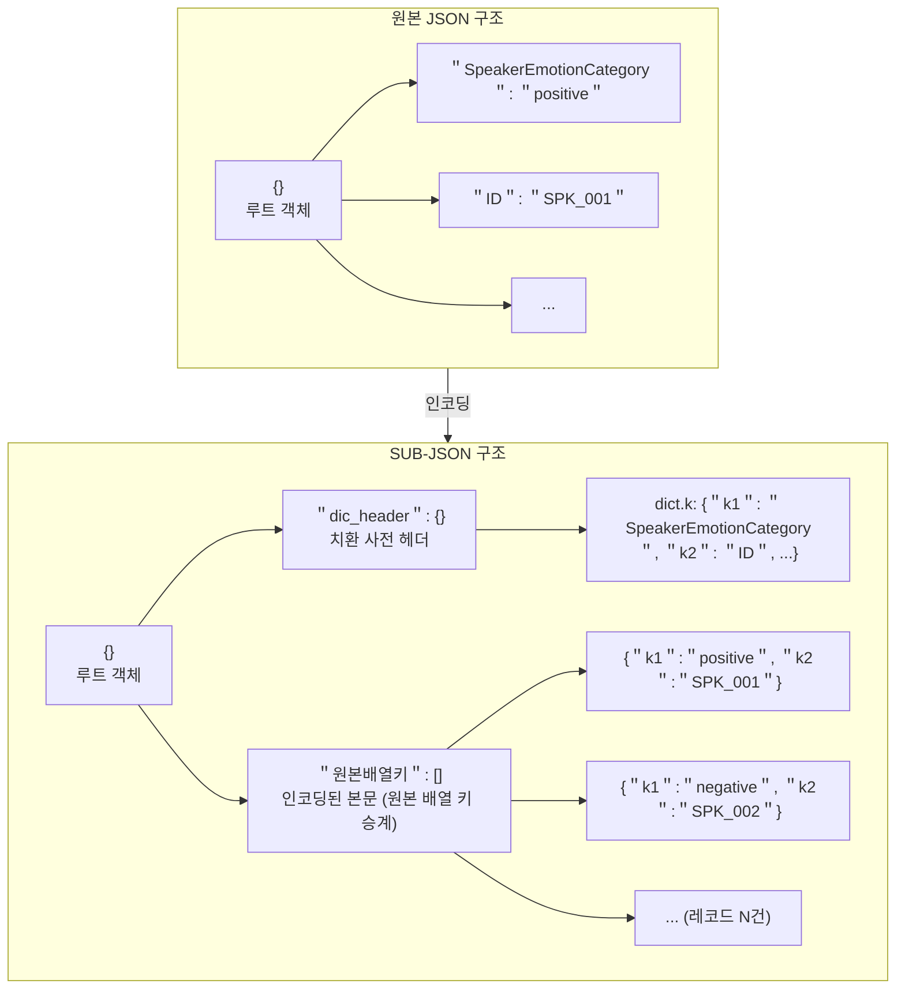
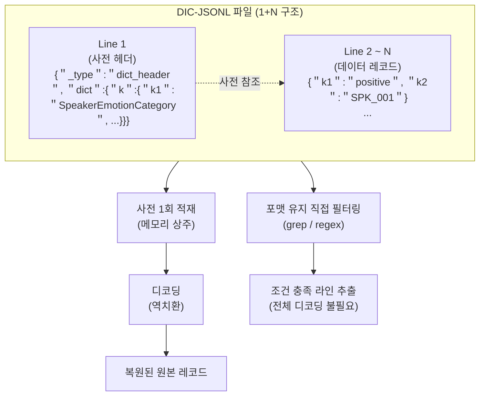

# 적응형 대응코드 시스템을 이용한 JSON/JSONL의 포맷 유지 압축 방법

김명환*, 이성만†

## 요약

AI 학습용 JSON/JSONL 파일은 동일한 키 문자열이 레코드에 반복 출현하는 구조적 특성을 가진다. Gzip, Brotli 등 범용 압축은 높은 압축률을 달성하지만 결과물을 바이너리로 변환하여 표준 JSON 파서로의 파싱이 불가능하며, 내용 확인 시 압축 해제가 필요하다는 운영상 제약이 따른다.

본 연구는 적응형 대응코드 시스템(Adaptive Correspondence Code System)을 이용한 JSON/JSONL 포맷 유지형 사전 치환 방법을 제안한다. 포맷·시스템 구성 측면에서, 코드-원문 매핑 사전을 동일 파일 내 헤더에 JSON 객체로 내장하는 자기완비적(self-contained) SUB-JSON 및 DIC-JSONL 포맷을 제안하였다. 알고리즘 측면에서, 반복 키를 첫 등장 순서 기준으로 순차 할당하는 결정론적 대응코드 생성 절차를 정의하여 재현성을 보장한다. 결과물은 표준 JSON 파서와 텍스트 편집기로 열람 가능한 JSON/JSONL 텍스트를 유지한다.

AI 허브 감정 태깅 자유대화 데이터(100건~7,000건)와 온라인 구어체 말뭉치 데이터(100건~20,000건)를 대상으로 한 두 데이터셋 9개 규모 조합 전체에서 라운드트립 무결성 검증을 통과하였으며, 레코드 수와 무관하게 동일한 키 치환 수가 유지되어 결정론적 재현성이 확인되었다. 감정 태깅 데이터에서 JSONL_Encoder는 평균 41.71%의 파일 크기 축소율을 기록하였고, 구어체 데이터에서는 동일 방법으로 8.72%의 축소율을 기록하였다. 두 데이터셋 간 차이는 고유 키 수와 평균 키 길이에 의해 결정됨을 분석하였다. 또한 DIC-JSONL 방식은 레코드 수가 100건에서 7,000건으로 70배 증가하는 동안 인코딩 메모리 사용량이 약 2.5배 증가에 그쳐, 스트리밍 특성이 인코딩 후에도 보존됨이 확인되었다. 단, 키 길이가 짧거나 고유 키 수가 적은 데이터셋에서는 절감률이 제한될 수 있다.

**키워드**: JSON 사전 치환, JSONL, 포맷 유지 압축, 적응형 대응코드, AI 학습 데이터

**\* 제1저자**: 서울사이버대학교 인공지능학과 학생 (12600487@iscu.ac.kr)
**† 교신저자**: 서울사이버대학교 빅데이터·정보보호학과 교수 (trex99@iscu.ac.kr)

---

# 1. 서론

인공지능(AI) 기술이 산업 전반에 확산되면서 모델 학습에 필요한 데이터의 규모가 지속적으로 증가하고 있다. JSON(JavaScript Object Notation)은 텍스트 기반 구조, 다양한 언어와의 호환성, 계층적 데이터 표현 능력을 바탕으로 AI 학습 데이터, API 통신, 구성 파일 등에서 표준 포맷으로 자리잡았다[1]. IETF RFC 8259로 표준화된 JSON은 스키마 정의 없이도 구조화된 데이터를 표현할 수 있어 프로토타입 개발부터 대규모 운영 환경까지 활용된다[1].

AI 모델 학습 데이터 포맷으로는 JSON Lines(JSONL)가 널리 사용된다. 각 행이 독립적인 JSON 객체로 완결되는 이 구조는, 대규모 언어 모델(LLM) 학습을 위한 말뭉치 구축 연구인 'The Pile'[2] 등에서 데이터 처리 효율을 위해 채택되었다. JSONL은 파일 전체를 메모리에 적재할 필요 없이 라인 단위의 스트리밍 처리를 지원하므로, 대용량 데이터셋의 병렬 I/O 및 전처리 공정에서 널리 사용된다.

최근 AI 모델의 규모가 커짐에 따라 학습 데이터의 크기 또한 지속적으로 증가하고 있다. 본 연구에서 활용한 AI 허브의 '감정이 태깅된 자유대화(134-2)'[3] 데이터셋 역시 어노테이션 파일 크기가 대용량화 되는 추세이다. 이처럼 대규모 데이터 환경에서는 저장 공간 절감을 위한 압축이 필요해지지만, Gzip이나 Brotli 등 기존 범용 압축 방식은 결과물을 바이너리 형식으로 변환하여 표준 JSON 파서나 텍스트 편집기로 원본 JSON 구조를 열람하거나 편집할 수 없게 만든다. 데이터를 검증하거나 수정하려면 파일의 압축을 해제해야 하며, 이는 반복적인 추가 공정을 수반한다. 이 문제는 JSON 포맷의 텍스트 구조를 유지하면서도 파일 크기를 줄일 수 있는 별도의 방법이 필요함을 시사한다.

AI 학습 데이터는 동일한 키 이름이 레코드에 걸쳐 반복 출현하고, 각 레코드가 동일한 필드 구조를 가지는 균일한 스키마 형태를 띤다. 예를 들어 '감정이 태깅된 자유대화(134-2)'[3] 데이터셋에서는 "SpeakerEmotionCategory", "VerifyEmotionCategory", "SpeakerEmotionTarget", "Text" 등 길이가 긴 키 문자열이 전 레코드에 걸쳐 반복된다. 이러한 구조적 반복성은 키 문자열 자체가 파일 크기에서 차지하는 비중이 크다는 것을 의미하며, 키를 짧은 식별자로 치환하는 방식으로 파일 크기를 줄일 수 있는 근거가 된다.

Gzip[4], Brotli[5] 등 범용 압축 알고리즘은 압축률 극대화를 목표로 하며, 결과물을 바이너리 형식으로 변환한다. 이는 본 연구와 설계 목표 자체가 다른 기술이다. 반면 본 연구에서 제안하는 방법은 JSON/JSONL 텍스트 구조와 표준 파서 호환성을 유지하는 것을 목표로 하며, 두 방법은 상호 배타적 관계가 아니라 적용 목적이 다른 상호 보완적 접근이다.

Table 1은 동일한 JSON 데이터에 대해 범용 압축(Gzip)과 본 연구에서 제안하는 대응코드 시스템 기반 변환 결과의 출력 형태를 비교한 것이다. 이 비교는 압축률 경쟁이 아니라, 두 방법이 출력 포맷 측면에서 근본적으로 다른 특성을 가짐을 보이기 위한 것이다.

**Table 1** 원본·Gzip·제안 방법의 출력 형태 비교

| 상태 | 파일 내용 (일부) | 표준 JSON 파서 파싱 가능 여부 |
|---|---|---|
| 원본 JSON | `{"SpeakerEmotionCategory": "긍정", "Text": "..."}` | 가능 |
| Gzip 압축 후 | `1f 8b 08 00 00 00 00 00 00 03 ...` (바이너리) | 불가 |
| 제안 방법 적용 후 | `{"k1": "긍정", "k8": "..."}` (유효한 JSON) | 가능 |

Gzip(.gz)이나 Brotli(.br) 등으로 압축된 파일은 표준 JSON 파서로 직접 파싱할 수 없는 바이너리 데이터로 나타나며, 내용을 확인하기 위해서는 압축 해제 공정을 거쳐야 한다. 이러한 제약은 데이터셋을 관리하고 검증하는 과정에서 다음과 같은 실질적인 문제를 초래한다.

첫째, 데이터 검증 및 디버깅의 비효율성이다. 데이터의 품질 관리와 오류 추적 시, 연구자는 텍스트 편집기나 표준 CLI 도구를 이용하여 파일을 열어 키-값 구조를 확인할 수 있어야 한다. 그러나 바이너리 압축 방식은 소수의 레코드를 확인하기 위해서 압축 해제 도구를 실행해야 하며, 이는 데이터셋의 구조적 결함이나 예외 데이터를 탐색하는 과정에서 압축 해제 단계가 추가되어야 한다.

둘째, 데이터 핸들링의 유연성 부재이다. 압축된 상태에서는 원본 텍스트에 대한 직접적인 수정, 필터링, 혹은 레이블 정정 등의 편집 작업이 어렵다. 이는 데이터셋을 수정하기 위해서는 '압축 해제-수정-재압축'이라는 공정을 수반함으로써 전체 데이터 파이프라인의 운영 효율을 떨어뜨린다.

결과적으로, 범용 바이너리 압축 기술은 저장 공간 절감이라는 목적은 달성하지만, JSON 포맷을 소멸시키고 데이터 검증, 수정, 필터링 등 후속 작업마다 압축 해제라는 별도 공정을 수반한다는 운영상 제약을 갖는다.

본 연구는 "적응형 대응코드 시스템(Adaptive Correspondence Code System)"에 기반한 AI 학습 데이터의 JSON/JSONL 포맷 유지 압축 방법을 제안한다. 핵심 원리는 JSON 또는 JSONL 데이터에서 반복 출현하는 키(key)를 짧은 대응코드(kN 형식)로 치환하되, 치환 전후 결과가 모두 유효한 JSON 문법을 유지하도록 하는 것이다. 대응코드와 원본 문자열 사이의 매핑 정보는 사전(dictionary) 형태로 파일 내 헤더 영역에 JSON 객체로 삽입되므로, 압축 결과 파일도 표준 JSON 파서가 읽을 수 있는 유효한 텍스트 파일로 남는다. 또한 대응코드 사전을 파일 내부에 내포하여 자기완비적 구조를 갖는다.

본 연구는 두 가지 측면에서 기존 방법과 구별된다. 첫째, 포맷·시스템 구성 측면에서 코드-원문 매핑 사전을 외부 파일 없이 동일 파일 내에 내장하는 자기완비적 SUB-JSON 및 DIC-JSONL 포맷을 제안하였다. 둘째, 알고리즘 측면에서 첫 등장 순서 기준의 순차 코드 할당 절차를 정의하여 동일 입력에 대해 항상 동일한 코드를 생성하는 결정론적 재현성을 보장한다.

본 논문에서 제안하는 방법은 저자가 출원한 특허 2건[13][14]에 기반하며, 두 가지 포맷 변형을 제공한다. SUB-JSON은 단일 JSON 객체 또는 중간 규모 데이터셋에 적합하며, DIC-JSONL은 대규모 데이터셋을 대상으로 JSONL 포맷을 유지하면서 스트리밍 처리를 가능하게 한다.

본 논문의 구성은 다음과 같다. 제2장에서는 JSON 기반 구조 유지 압축 기술, 사전 기반 압축 기법, 그리고 대규모 AI 학습 환경에서 JSONL이 차지하는 역할과 관련된 기존 연구 및 기술 동향을 검토한다. 제3장에서는 적응형 대응코드 기반 압축 방법의 시스템 아키텍처, 핵심 알고리즘의 이론적 근거, SUB-JSON 및 DIC-JSONL 포맷의 구성 원리를 기술한다. 제4장에서는 실제 데이터셋을 대상으로 포맷 유지, 복원 무결성, 파일 크기 절감을 검증한 실험 결과를 제시한다. 제5장에서는 연구 결과를 요약하고 제안 방법의 한계와 향후 연구 방향을 제시한다.

---

# 2. 관련 연구

본 장에서는 JSON 기반 데이터 압축 및 구조 유지 기법, 사전 기반 압축 기법, 그리고 AI 학습 데이터에 활용되는 JSON/JSONL 포맷의 운용 현황 등 관련 연구 분야를 검토하고, 제안 방법이 기존 기술의 어떠한 한계를 보완하기 위해 제안되었는지 배경을 제시한다.

## 2.1 JSON 포맷과 구조 유지 압축 기술

JSON(JavaScript Object Notation, 자바스크립트 객체 표기법)은 웹 환경 및 AI 데이터 파이프라인에서 널리 사용되는 데이터 교환 포맷이다. 이 포맷은 인간이 읽을 수 있는(human-readable) 텍스트 형태이면서 파서(parser, 구문 분석기)를 통해 트리 형태의 자료구조로 변환될 수 있다. 그러나 JSON 문서에서 반복적으로 나타나는 키(key) 이름과 구조적 괄호, 공백 등은 데이터 중복을 야기하며, 파일 크기 증가의 원인이 된다.

이러한 문제를 해결하기 위해 BSON[7], MessagePack[8], CBOR[9]과 같은 바이너리 직렬화(binary serialization) 포맷들이 제안되었다. 이들 기술은 데이터 타입과 구조 정보를 바이너리 코드로 인코딩하여 파일 크기를 줄이고 파싱 속도를 향상시켰다. 그러나 이러한 바이너리 변환 기법들은 파싱 과정에서 데이터의 역직렬화(deserialization)를 요구하므로, 원본 텍스트 구조에 접근하여 부분적인 데이터를 추출하거나 표준 JSON 파서로 직접 파싱하는 것이 불가능하다.

텍스트 기반 포맷의 구조를 유지하면서 압축을 수행하려는 연구로는 스키마 기반 압축(Schema-based compression) 기법이 있다. 이는 JSON Schema[10]를 별도의 문서로 분리 정의하고, 본문에서는 반복되는 키(key)를 생략한 채 값(value)만 배열 형태로 나열하는 방식이다. 그러나 이 방식은 외부 스키마 파일에 구조 해석을 의존하므로, 단일 파일 내에서는 키-값 매핑 정보를 확인할 수 없어 자기완비적 운용이 어렵다. 또한, 키가 수시로 추가되거나 변경되는 비정형(schemaless) 환경에서는 스키마를 지속적으로 갱신하고 동기화해야 하는 관리적 한계를 지닌다.

반복 출현하는 긴 문자열을 짧은 식별자로 치환하여 저장 공간을 절감하는 방법은 데이터 처리 분야 전반에서 일반적으로 활용된다. 그러나 이러한 치환 기법들은 결과물의 JSON/JSONL 포맷 유지를 설계 목표로 하지 않는다. 치환 결과를 별도의 변환 없이 표준 JSON 파서로 직접 파싱하거나, 복원에 필요한 매핑 정보를 외부 파일 의존 없이 단일 파일 내에서 자기완비적으로 관리하는 방법은 기존 기법에서 다루어지지 않는다. 본 연구는 이 두 가지 요건을 동시에 충족하는 것을 목표로 한다.

## 2.2 사전 기반 압축 기법

기존의 사전 기반 압축(Dictionary-based compression) 기법은 반복되는 문자열을 짧은 인덱스나 포인터로 치환하는 방식을 취하며, Lempel-Ziv 계열 알고리즘(LZ77, LZ78, LZW 등)이 대표적이다. 이 기술은 전체 텍스트에서 패턴을 동적으로 인식하고 사전을 구성하여 높은 압축 효율을 달성한다. 이러한 원리는 범용 압축 엔진인 Gzip[4]이나 Brotli[5] 등의 알고리즘에서도 채택되어 사용된다.

그러나 이러한 범용 압축 알고리즘들은 결과적으로 압축 데이터를 바이너리 블록으로 출력한다. 사전 기반 접근법이 파일 내 중복 제거라는 목표에는 부합하지만, 치환된 포인터 구조가 이진 체계(binary system)로 기록되기 때문에 표준 JSON 파서로의 직접 파싱이 불가능하다. 나아가, 데이터의 특정 라인이나 객체 부분에만 접근하려 해도 압축 블록이나 프레임을 메모리에 적재한 후 압축을 해제하는 연산 과정을 거쳐야 한다.

본 연구의 접근법은 전통적인 사전 기반 압축의 '패턴 치환(pattern substitution)' 개념을 적용하되, 치환된 코드가 유효한 JSON 문자열(valid JSON string) 요건을 충족하도록 하고 사전을 파일 내에 JSON 객체 형태로 배치하는 것이다. 이는 범용 압축 알고리즘이 JSON 포맷을 소멸시키는 한계를 해소하기 위함이다.

## 2.3 AI 학습 데이터 처리 체계의 동향

대규모 언어 모델(LLM, Large Language Model)의 발전으로 테라바이트 단위 이상의 텍스트 데이터셋을 다루는 환경이 일반화되었다. 이러한 환경에서는 파일 전송 속도 및 디스크 입출력(Disk I/O) 성능이 전체 파이프라인의 병목 지점이 된다. 이를 개선하기 위해 Apache Parquet, Apache Arrow와 같은 컬럼 기반 저장소(Columnar Format) 및 인메모리(in-memory) 분석 포맷이 딥러닝 프레임워크와의 연동에 채택되고 있다[11].

하지만 데이터의 수집, 정제, 전처리 단계 등 파이프라인의 초기 영역에서는 여전히 JSON 및 JSONL이 표준 인터페이스 역할을 담당한다. JSONL 포맷은 각 행이 독립적인 객체로 구성되어 있어 분산 환경에서 단순 분할(split) 처리가 가능하고, 장애 발생 시 재시도 지점을 라인 단위로 특정하기 용이하다. 최근 대규모 텍스트 큐레이션(text curation) 체계에서도 JSONL은 로컬 워크스테이션 입력 포맷으로 명시되며, 파일 경로·파티션 크기·읽을 필드만 지정하여 단계적 필터링과 전처리 파이프라인에 연결하는 방식이 채택되고 있다[12]. 그러나 JSONL 포맷은 텍스트 기반 특성상 동일한 키 문자열이 모든 레코드에 반복 기록되므로, JSON/JSONL 포맷을 유지한 채로는 파일 크기 측면에서 개선 여지가 있다.

따라서, 텍스트 구조와 JSON 파서 호환성을 그대로 유지하면서 반복 키 문자열을 짧은 식별자로 축약하는 방법이 요구된다. 본 논문에서 제안하는 적응형 대응코드 시스템은 이 두 가지 요구사항, 즉 데이터 크기 감소(Data Size Reduction) 및 JSON/JSONL 포맷 유지(Format Preservation)를 충족하기 위해 제안되었다.

---

# 3. 제안 방법

본 장에서는 적응형 대응코드(Adaptive Correspondence Code) 기반의 데이터 압축 방법의 시스템 아키텍처와 주요 알고리즘을 설명한다. 또한 본 기법을 단일 JSON에 적용한 SUB-JSON(Substituted JSON) 포맷과, 라인 단위 스트리밍을 지원하는 구조인 DIC-JSONL(Dictionary-based JSON Lines) 포맷의 구성 원리를 각각 구분하여 논한다.

## 3.1 적응형 대응코드 시스템 아키텍처

본 연구가 제안하는 시스템은 원시 JSON 또는 JSONL 데이터를 분석하여 반복 출현하는 키(key)를 짧고 고유한(unique) 대응코드(예: k1, k2 등)로 치환하는 전 과정을 처리한다. 시스템의 알고리즘 파이프라인은 JSON과 JSONL 포맷에 공통으로 적용되는 네 개의 모듈로 구성된다.

첫째, 포맷추출부(FormatExtractor)이다. 이 모듈은 입력 데이터를 순회하며 JSON 객체의 구조를 검출한다. 둘째, 포맷서치부(FormatSearcher)이다. 이 모듈은 추출된 데이터에서 키의 출현 빈도와 문자열 길이를 집계하고, 치환 시 파일 크기 절감이 발생하는 키를 대응코드 사전에 등록한다. 사전에 포함될 키의 선정 기준에 대한 이론은 제3.3절에서 논의한다. 셋째, 포맷압축부(FormatCompressor)이다. 이 모듈은 생성된 사전을 이용해 원본 데이터의 키를 대응코드로 치환하고, 사전 정보와 인코딩된 본문 데이터(Payload)를 결합하여 출력 포맷에 따라 SUB-JSON 또는 DIC-JSONL 파일을 생성한다. 넷째, 포맷복원부(FormatRestorer)이다. 이 모듈은 파일에 내장된 사전을 참조하여 대응코드를 원문 문자열로 역매핑함으로써 키-값 무결성을 보장하는 복원을 수행한다.

본 연구는 키(key) 치환만을 핵심 압축 수단으로 채택하였다. 값(value) 문자열은 엔트로피가 높고 변동성이 커서 치환 시 사전 규모가 비대해질 수 있다. 반면, 키는 데이터의 스키마를 형성하는 높은 반복성을 갖는 문자열이므로, 키 중심의 `k` 접두사 치환으로 구조적 중복을 제거한다[13][14]. 값 치환은 본 연구의 범위 밖으로, 키 치환만을 대상으로 한다.

대응코드는 접두사와 인덱스의 조합(예: `k1`, `k2`)으로 구성되며, 코드 할당 시 제3.2절에서 상세히 기술하는 결정론적 순차 할당 절차를 사용한다. 이 절차는 원본 데이터 내 기존 문자열과의 충돌을 방지하고, 동일 입력에 대해 항상 동일한 코드를 생성하는 결정론적(deterministic) 특성을 보장하여 인코딩과 디코딩의 무결성(integrity)과 재현성(reproducibility)을 확보한다.



**Fig. 1** 적응형 대응코드 시스템 처리 파이프라인 아키텍처

## 3.2 결정론적 대응코드 할당 절차

대응코드 할당의 핵심 문제는 생성하려는 코드가 원본 데이터 내 기존 문자열 및 이미 사전에 등록된 코드와 충돌하지 않도록 보장하는 것이다. 이를 위해 본 연구는 해시 테이블의 개방 주소법(Open Addressing)에서 확립된 선형 탐사(Linear Probing) 원리[6]를 코드 인덱스 결정 절차에 적용한다.

본 실험에서 주된 치환 대상은 키(key) 문자열이며, 대응코드 접두사로 `k`를 사용한다. 탐사 함수는 다음과 같이 정의된다.

$$h(i) = \text{k} \parallel i, \quad i \in \mathbb{Z}^+$$

여기서 $i$는 탐사 인덱스이며, $\parallel$은 문자열 결합 연산을 의미한다. 시스템은 $i = 1$부터 순차적으로 탐색하여, 생성된 후보 코드 $c_i = h(i)$가 다음 조건을 만족하는 최소의 $i$를 선택한다.

$$i^* = \min \{ i \in \mathbb{Z}^+ \mid c_i \notin D_{org} \text{ 이고 } c_i \notin \text{keys}(\mathcal{D}) \}$$

단, $D_{org}$는 원본 데이터 내의 전체 고유 문자열 집합이며, $\mathcal{D}$는 해당 시점까지 구축된 대응코드 사전이다. 이미 할당된 코드는 사전 $\mathcal{D}$의 키로 관리되므로, 별도의 집합 없이 사전 조회만으로 중복을 방지할 수 있다.

코드 할당 순서는 **키의 첫 등장 순서**를 기준으로 한다. 전체 레코드를 순회하면서 키를 처음 만나는 순서대로 순차적으로 대응코드를 부여한다. 이 순서 규칙이 결정론적 재현성의 핵심 근거이다. 동일한 입력 데이터에 대해 항상 동일한 순서로 키가 등장하므로, 항상 동일한 코드가 할당된다.

충돌이 발생하면 인덱스를 순차적으로 증가시켜 탐색하므로, 원본 데이터에 `k1`이라는 문자열이 이미 존재하는 경우 해당 코드를 건너뛰고 `k2`를 할당하는 방식으로 안전한 최단 코드를 결정론적으로 선택한다. 사전 $\mathcal{D}$는 인코딩과 디코딩 단계에서 동일하게 재현되므로, 키-값 무결성 복원의 재현성(reproducibility)을 보장한다.

선형 탐사의 시간 복잡도는 충돌이 없는 경우 $O(1)$이며, 충돌 연쇄가 발생하더라도 탐사 횟수는 사전 $\mathcal{D}$의 크기에 의존한다. 실제 AI 학습 데이터에서 치환 대상 키의 수는 데이터셋 규모와 무관하게 스키마에 의해 고정되므로, $|\mathcal{D}|$는 상수에 수렴한다. 본 실험에서 레코드 수(100건~7,000건)와 무관하게 $|\mathcal{D}| = 47$이 일관되게 유지된 결과는 이러한 특성과 일치한다.

## 3.3 압축 분석 공식

제안 방법의 파일 크기 절감량은 각 키의 문서 전체 출현 횟수와 키 문자열 길이 특성에 의해 결정된다. 키 $i$의 문서 전체 출현 횟수를 $f_i$라 할 때, 치환으로 절감되는 총 바이트 수 $\Delta B$는 다음 근사식으로 정의된다.

$$\Delta B \approx \sum_{i=1}^{N_{key}} f_i \cdot (L_{key,i} - L_{code,i})$$

여기서 $f_i$는 키 $i$가 문서 전체에서 출현한 횟수이며, $L_{key,i}$는 원본 키 $i$의 바이트 길이, $L_{code,i}$는 대응코드 $i$의 바이트 길이, $N_{key}$는 고유 키 수이다. $f_i$는 JSON 구조의 중첩 깊이나 스키마 형태와 무관하게 실제 출현 횟수를 직접 반영하므로, 단일 레벨 스키마와 계층적 스키마를 구분 없이 동일한 공식으로 다룰 수 있다.

이 공식에서 $(L_{key,i} - L_{code,i})$가 음수인 항이 존재하면, $f_i$가 클수록 해당 항의 손실이 누적된다. 예를 들어 "aa"(2바이트)가 k10(3바이트)으로 할당되면 해당 항은 $-1$이 되어 출현 횟수 증가에 따라 전체 크기가 팽창하는 손실이 발생할 수 있다. 따라서 키 분포 특성에 따라 이 공식을 참고하여 치환 적용 여부를 사전에 판단할 수 있다. 본 실험 데이터셋에서는 이러한 손실 케이스가 발생하지 않았음이 실험을 통해 확인되었다.

위 근사식은 키 치환으로 절감되는 바이트만을 대상으로 하며, 사전 헤더 오버헤드는 포함하지 않는다. 사전 헤더는 파일당 1회 기록되는 고정 비용으로, $f_i$가 충분히 큰 경우 전체 파일 크기 대비 무시 가능한 수준이 된다.

이 공식은 임의의 데이터셋에 대해 압축률을 사전에 추정할 수 있는 이론적 도구를 제공한다. 고유 키 수($N_{key}$)가 많고 각 키 길이($L_{key,i}$)가 길수록, 그리고 출현 횟수($f_i$)가 많을수록 치환 적용이 유리하다.

## 3.4 SUB-JSON: 단일 객체 지향형 구조 압축 포맷

SUB-JSON은 일반적인 JSON 데이터에 적응형 대응코드를 적용하기 위해 고안된 포맷이다. 이 포맷의 특징은 압축의 결과물 자체가 하나의 유효한 JSON 루트 객체(Root Object)를 형성한다는 점이다. 파일의 루트 계층은 `"dic_header"` 필드(사전 헤더)와 원본 배열 데이터 필드로 구성된다.

`"dic_header"` 영역은 인코더가 생성한 치환 사전으로, 치환 코드와 원본 키의 1:1 매핑을 저장한다. 데이터 배열 영역에는 키가 대응코드로 치환된 본문이 위치하며, 배열 필드명은 원본 JSON의 배열 키를 그대로 승계한다(부록 A.1 참조). 이 구조는 복호화에 필요한 사전을 단일 파일 내에 자기완비적(self-contained)으로 내장한다.



**Fig. 2** SUB-JSON 포맷 구조: 원본 JSON에서 치환 사전 내장형 단일 객체로의 변환

SUB-JSON은 일반 텍스트 편집기나 표준 JSON 파서로 직접 열람하고 파싱할 수 있다. 다만, 트리(tree) 구조의 특성상 파일의 전체 문법을 파싱하기 위해서는 닫는 괄호 `}`가 파일 끝에 위치할 때까지 읽기를 완료해야 하므로, 데이터에서는 전체 파일 메모리 적재가 필요할 수 있다.

## 3.5 DIC-JSONL: 스트리밍 라인 단위 압축 포맷

DIC-JSONL(Dictionary-based JSON Lines) 포맷은 대규모 데이터 파이프라인에서 요구되는 라인 단위 스트리밍(streaming) 처리를 지원하면서 사전을 자기완비적으로 내장하기 위해 제안되었다. DIC-JSONL은 파일 전체를 메모리에 일괄 적재하지 않고, JSONL 라인을 스트리밍 방식으로 읽으면서 키의 첫 등장 순서를 기준으로 대응코드 사전을 구축하고 확장한다. 스키마가 사전에 고정되어 있지 않아도 실제 데이터의 키 분포에 따라 대응코드를 자동으로 생성하며, 동일 입력 데이터에 대해 항상 동일한 코드가 생성되는 결정론적 재현성은 유지된다. 기존 JSONL 파일은 매 줄이 독립된 객체이므로 스트리밍에 적합하지만, 사전 기반 치환 기법을 적용할 경우 각 줄이 사전에 어떻게 접근할 것인가라는 참조 문제가 대두된다. 모든 라인마다 사전을 복사해 넣으면 오히려 용량이 증가하며, 외부 사전 파일로 명시할 경우에는 단일 파일 운용의 편리성이 저해된다.

제안하는 DIC-JSONL 구조는 이를 해결하기 위해 파일의 첫 번째 라인(Line 1)에 메타데이터와 사전 정보를 단일 JSON 객체 형태로 배치하고, 그 이후 라인부터 대응코드로 치환된 데이터 객체들을 차례로 나열하는 1+N 구조를 채택하였다. 사전 헤더 레코드의 구조는 다음과 같이 정의된다.

```json
{"_type": "dict_header", "version": 1, "dict": {"k": {"k1": "SpeakerEmotionCategory", "k2": "ID", ...}}}
```

파서는 첫 줄의 사전 헤더를 메모리에 적재한 뒤, 이어지는 JSONL 라인들에 대해 역치환(decoding)을 수행하거나, 압축된 상태 자체를 직접 필터링할 수 있다. 이로써 첫 번째 라인에 사전 정보를 내장한 자기완비적 단일 파일 구조를 갖는다.

DIC-JSONL은 치환 후에도 결과물이 평문 텍스트 형태를 유지하므로, 압축 상태에서도 정규식이나 키워드 검색을 통해 조건을 만족하는 라인을 추출할 수 있다.



**Fig. 3** DIC-JSONL 포맷의 1+N 구조 및 스트리밍 처리 흐름

DIC-JSONL의 스트리밍 방식은 원본 JSONL의 줄 단위 파싱 특성을 그대로 승계하므로, 대규모 데이터 처리 시에도 파일 크기와 무관하게 메모리 사용량이 사전 크기($|\mathcal{D}|$, 상수)에 수렴하는 구조적 이점을 갖는다. 이는 4.4절 실험에서 레코드 수 증가에 따른 JSONL_Encoder의 메모리 사용량이 사실상 일정하게 유지되는 결과로 확인된다.

한편, 치환으로 길이가 축소된 DIC-JSONL 파일을 Gzip, Brotli 등으로 2차 압축할 경우 반복 문자열 매칭 효율이 향상되어 추가적인 압축률 개선으로 이어질 수 있음이 실험을 통해 확인되었으나, 이는 본 연구의 부가적 활용 방향이며 최종 출력이 바이너리로 변환되어 포맷 유지라는 핵심 목적의 범위 밖에 해당한다.

---

# 4. 실험 결과

본 실험은 제안 방법이 원본 데이터의 키-값 무결성을 보장하며 복원 가능함을 검증하는 데 목적이 있다. 평가는 동일 조건에서 측정 가능하도록 구성된 자체 벤치마크 절차에 따라 수행하였으며, 실험 결과는 포맷 유지 검증, 무결성 검증, 파일 크기 절감, 메모리 사용량의 네 가지 관점에서 보고한다.

## 4.1 실험 환경 및 데이터셋 구성

실험은 Windows 11 Pro, Intel Core i7-1260P(12코어 16스레드, 기본 클럭 2.10GHz), 32GB RAM, NVMe SSD 환경에서 수행하였으며, 실행 인터프리터는 Python 3.12.12이다. 치환 대상 키 선정은 3.3절의 $\Delta B$ 근사식에 따라 치환 시 파일 크기 절감이 발생하는 키를 등록하는 원칙을 따르며, 본 실험에서는 키만 치환 대상으로 한다.

실험에는 두 가지 AI 허브 대화 말뭉치 계열 샘플을 사용하였다. 첫 번째는 감정이 태깅된 자유대화 청소년 TL 01 실내(이하 감정 태깅 데이터)[3]이며, 동일 스키마를 갖는 JSON 레코드가 반복되는 전형적인 학습 데이터 형태를 가진다. 두 번째는 온라인 구어체 말뭉치 데이터[15]로, 게시글 본문과 댓글 구조를 포함하는 계층적 말뭉치 데이터이다. 두 데이터셋은 구조적 복잡성과 키 문자열 길이 측면에서 서로 다른 특성을 지니며, 이를 비교함으로써 제안 방법의 압축 효율에 영향을 미치는 요인을 분석할 수 있다.

감정 태깅 데이터의 실험 레코드 수는 100, 1,000, 5,000, 7,000건이며, 각 원본 파일 크기는 각각 8.97MB, 94.77MB, 506.06MB, 754.44MB이다. 구어체 데이터의 실험 레코드 수는 100, 1,000, 5,000, 7,000, 20,000건이며, 각 원본 파일 크기는 1.37MB, 48.63MB, 441.82MB, 501.02MB, 1,399.57MB이다. 파일 크기 절감률 및 키 치환 수는 결정론적 변환의 특성상 반복 측정값이 일치함을 확인하였으며, 메모리 사용량은 OS 환경 변동을 고려하여 5회 측정한 평균값을 사용하였다. 메모리 사용량은 tracemalloc 피크 메모리를 기준으로 측정하였다.

## 4.2 포맷 유지 분석

Fig. 4는 원본 JSON을 범용 압축(Gzip)과 JSONL_Encoder로 각각 변환한 결과의 출력 형태를 비교한 것이다. Gzip 압축 결과는 이진 데이터로 변환되어 표준 JSON 파서나 텍스트 편집기로 직접 읽을 수 없는 반면, JSONL_Encoder의 결과는 키가 대응코드로 치환되었음에도 JSONL 형식의 텍스트를 유지하므로, 표준 JSON 파서나 텍스트 편집기로 열람과 파싱이 가능하다.

<!-- 직접 이미지 삽입 -->

**Fig. 4.** JSONL_Encoder(텍스트 출력) vs Gzip(이진 출력) 포맷 비교

**Table 2** 포맷 유지 여부 비교

| 방법                          | 표준 JSON 파서 파싱 | 텍스트 편집기 열람 | 키 원문 의미 유지      |
| --------------------------- | ------------- | ---------- | --------------- |
| 원본 JSON/JSONL               | 가능            | 가능         | 유지              |
| Gzip 압축                     | 불가            | 불가         | 소멸              |
| 제안 방법 (SUB-JSON, DIC-JSONL) | 가능            | 가능         | 소멸 (사전으로 복원 가능) |

## 4.3 무결성 및 결정론성 검증

제안 방법이 사용 가능하기 위해서는 압축과 복원 이후 원본 JSON 객체의 모든 키-값 쌍이 동일하게 복원되어야 한다. 인코딩 전 원본 데이터와 복원된 데이터의 라운드트립 검증을 수행하였다. JSON 객체는 키 순서가 구현마다 다를 수 있으므로, 키를 사전순으로 정렬한 직렬화 문자열로 비교하는 방식으로 논리적 동일성을 검증하였다.

그 결과, 감정 태깅 데이터(100건, 1,000건, 5,000건, 7,000건)와 구어체 데이터(100건, 1,000건, 5,000건, 7,000건, 20,000건) 전체 조합에서 JSON_Encoder와 JSONL_Encoder가 각각 모든 무결성 검증을 통과하였다. 또한 레코드 수와 무관하게 치환 키 수가 일관되게 유지되어 결정론성이 확인되었다. 이는 제안 방법이 임의의 바이트 시퀀스를 생성하는 범용 바이너리 압축과 달리, 키 수준의 구조 정보를 사전(dict) 형태로 동일 파일 내에 내장하고 본문에서는 대응코드를 사용한다는 구성 특성에서 비롯된다.

**Table 3** 라운드트립 무결성 검증 결과 (검증 방법: 키 정렬 직렬화 비교)

| 데이터셋 | 레코드 수 | `JSON_Encoder` | `JSONL_Encoder` |
|---|---|---|---|
| 감정 태깅 | 100 | PASS | PASS |
| 감정 태깅 | 1,000 | PASS | PASS |
| 감정 태깅 | 5,000 | PASS | PASS |
| 감정 태깅 | 7,000 | PASS | PASS |
| 구어체 | 100 | PASS | PASS |
| 구어체 | 1,000 | PASS | PASS |
| 구어체 | 5,000 | PASS | PASS |
| 구어체 | 7,000 | PASS | PASS |
| 구어체 | 20,000 | PASS | PASS |
| **합계** | | **9/9 PASS** | **9/9 PASS** |

**Table 4** 레코드 크기별 키 치환 수 (결정론성 확인)

| 방법 | 데이터셋 | 100건 | 1,000건 | 5,000건 | 7,000건 | 20,000건 |
| --- | --- | --- | --- | --- | --- | --- |
| `JSON_Encoder` | 감정 태깅 | 47 | 47 | 47 | 47 | — |
| `JSONL_Encoder` | 감정 태깅 | 47 | 47 | 47 | 47 | — |
| `JSON_Encoder` | 구어체 | 13 | 13 | 13 | 13 | 13 |
| `JSONL_Encoder` | 구어체 | 13 | 13 | 13 | 13 | 13 |

## 4.4 메모리 사용량 분석

DIC-JSONL(JSONL_Encoder)이 원본 JSONL의 스트리밍 특성을 인코딩 후에도 유지하는지 검증하기 위해 tracemalloc 피크 메모리를 측정하였다. 반복 실험으로 메모리 점유량이 일정하게 유지되는지 확인하여, 원본 JSONL의 스트리밍 특성이 인코딩 후에도 유지됨을 검증하였다.

**Table 5** 레코드 수별 인코딩 피크 메모리 (감정 태깅 데이터 기준, 단위: MB)

| 레코드 수 | JSON_Encoder | JSONL_Encoder |
|---|---|---|
| 100 | 37.18 | 5.87 |
| 1,000 | 371.21 | 11.05 |
| 5,000 | 2,151.27 | 14.86 |
| 7,000 | 2,954.68 | 14.86 |

JSONL_Encoder(DIC-JSONL)는 레코드 수가 100건에서 7,000건으로 70배 증가하는 동안 인코딩 메모리가 5.87MB에서 14.86MB로 약 2.5배 증가하는 수준에 그쳐, 원본 JSONL의 스트리밍 특성이 인코딩 후에도 유지됨이 확인된다. 이 메모리 상한 특성은 데이터셋의 스키마 구조나 내용과 무관하게, 첫 번째 라인에 사전을 내장하고 이후 라인을 순차 처리하는 DIC-JSONL의 1+N 구조 자체에서 비롯된다. 반면 JSON_Encoder(SUB-JSON)는 레코드 수에 비례하여 메모리가 선형 증가하며, 대규모 데이터에서는 OOM(Out of Memory) 위험이 발생할 수 있다. 이는 SUB-JSON은 JSON와 동일하게 전체 데이터를 메모리에 적재하는 구조적 특성에서 비롯된 것으로, 대규모 데이터에서는 DIC-JSONL 사용이 권장된다.

## 4.5 파일 크기 절감 분석

본 절에서는 키 치환으로 발생하는 구조적 파일 크기 절감을 측정한다.

**Table 6** 데이터셋별 평균 파일 크기 절감률

| 데이터셋 | JSON_Encoder (SUB-JSON) | JSONL_Encoder (DIC-JSONL) |
| --- | --- | --- |
| 감정 태깅 데이터 | 38.96% | 41.71% |
| 온라인 구어체 데이터 | 8.43% | 8.72% |

감정 태깅 데이터에서 JSONL_Encoder의 평균 파일 크기 절감률은 41.71%이며, 데이터 크기가 증가해도 41.62%에서 41.94% 범위에서 유지되었다. 구어체 데이터에서는 동일 방법으로 평균 8.72%를 기록하였으며, 절감률은 5.87%에서 9.60% 범위로 나타났다. 100건에서 5.87%로 상대적으로 낮은 것은 337바이트의 헤더 오버헤드가 소규모 파일(1.37MB)에서 차지하는 비중이 크기 때문이며, 레코드 수가 증가할수록 9% 후반대로 수렴하였다. JSON/JSONL 파일에 포함된 가독성용 공백(들여쓰기, 줄바꿈 등)은 데이터 생성 방식에 따라 상이하므로, 공백 제거에 의한 절감률은 원본 파일의 특성에 종속되는 오차 범위에 해당하며 본 실험의 측정 대상에서 제외하였다. 두 데이터셋 간 절감률 차이의 원인과 의미는 4.6절에서 분석한다.

실험 결과는 3.3절의 $\Delta B$ 근사식으로 이론적으로 설명할 수 있다. 감정 태깅 데이터의 경우 $N_{key}=47$, $\overline{L_{key}}=11.55$자, $\overline{L_{code}}=2.81$자이며, 구어체 데이터의 경우 $N_{key}=13$, $\overline{L_{key}}=6.92$자, $\overline{L_{code}}=2.31$자이다. 실험에서 집계된 각 키의 출현 횟수 $f_i$를 근사식에 대입하면 실측 절감량을 근사하게 설명할 수 있다. 근사식과 실측값 사이의 차이는 사전 헤더 오버헤드, 가독성용 공백·개행 처리 등 JSON 포맷 특성에서 비롯되나, 1,000건 이상의 실용적 규모에서는 원본 파일 크기 대비 0.002% 이내로 무시 가능한 수준이다. 구어체 데이터의 경우 레코드 내부에 댓글 배열이 중첩되어 $f_i$가 단순 레코드 수보다 크게 산출됨에도, $\Delta B$ 근사식은 스키마 구조에 관계없이 동일하게 적용 가능함이 확인된다.

## 4.6 데이터 특성에 따른 압축 효율 영향 요인 분석

4.5절에서 확인한 바와 같이, 제안 방법의 파일 크기 축소율은 두 데이터셋 간에 차이를 보인다. 감정 태깅 데이터에서는 JSONL_Encoder 기준 평균 41.71%의 절감률을 달성한 반면, 구어체 데이터에서는 동일 방법으로 8.72%에 그쳤다.

**Table 7** 두 데이터셋의 구조적 특성 비교

| 특성 | 감정이 태깅된 자유대화 청소년 | 온라인 구어체 말뭉치 |
|---|---|---|
| 고유 키 수 ($N_{key}$) | 47개 | 13개 |
| 평균 키 길이 ($\overline{L_{key}}$) | 11.55자 | 6.92자 |
| 평균 코드 길이 ($\overline{L_{code}}$) | 2.81자 | 2.31자 |
| 최장 키 길이 | 22자 (`SpeakerEmotionCategory`) | 11자 (`source_file`) |
| 최대 중첩 깊이 | 2 | 3 |
| JSONL_Encoder 평균 압축률 | 41.71% | 8.72% |

두 데이터셋 간 절감률 차이의 주된 원인은 구조적 복잡성이 아닌 키 문자열의 평균 길이와 고유 키 수 차이에 있다. 구어체 데이터는 최대 중첩 깊이 3으로 감정 태깅 데이터(최대 중첩 깊이 2)보다 구조적으로 복잡하나, 중첩 깊이의 차이에도 불구하고 $\Delta B$ 근사식은 스키마 구조와 무관하게 실제 키 출현 횟수 $f_i$를 직접 집계하므로, 압축 효율 차이는 중첩 깊이가 아닌 $N_{key}$와 $\overline{L_{key}}$에 의해 설명된다. 제안 알고리즘은 원본 키를 2~3자의 짧은 대응코드로 치환하므로, 치환으로 절감되는 바이트 수는 $(L_{key,i} - L_{code,i})$에 비례한다. 감정 태깅 데이터의 경우 평균 키 길이가 11.55자이므로 치환 한 번당 평균 약 8.7자가 절감되는 반면, 구어체 데이터의 평균 키 길이는 6.92자에 불과하여 치환 한 번당 평균 약 4.6자 절감에 그쳐 치환 효과가 제한된다. 또한 감정 태깅 데이터는 47개의 고유 키가 레코드마다 반복 출현하는 데 비해, 구어체 데이터는 13개의 키만이 치환 대상이므로 전체 파일에서 키 문자열이 차지하는 비중 자체가 작다.

3.3절에서 정의한 근사식으로 이를 정량적으로 설명하면, 구어체 데이터의 $\overline{L_{key}} = 6.92$자는 $\overline{L_{code}} = 2.31$자와의 차이가 작으므로 $\sum (L_{key,i} - L_{code,i})$가 작고, 그 결과 전체 압축률이 낮게 나타난다. 반면 감정 태깅 데이터는 $\overline{L_{key}} = 11.55$자로 차이가 크고, 47개의 고유 키가 레코드마다 반복 출현하므로 절감량이 크게 누적되어 높은 압축률로 이어진다.

이러한 분석은 제안 알고리즘의 압축 효율이 원본 키 문자열의 평균 길이($\overline{L_{key}}$), 고유 키 수($N_{key}$), 그리고 각 키의 문서 전체 출현 횟수($f_i$)에 종속됨을 보여준다. $f_i$는 스키마 구조(단일 레벨/계층적)와 무관하게 실제 출현 횟수를 직접 반영하므로, 구조적 복잡성과 관계없이 동일한 공식으로 절감량을 설명할 수 있다. 이는 입력 데이터의 키 속성에 따른 결정론적 특성이며, 4.5절 Table 6에서 $\Delta B$ 공식이 두 데이터셋 모두의 실험 측정값을 이론적으로 설명함으로써 실증되었다.

---

# 5. 결론 및 향후 연구

본 연구는 바이너리 기반 범용 압축이 JSON 포맷을 소멸시키는 운영상 제약을 해소하기 위해, 반복 출현하는 키를 짧은 대응코드로 치환하고 매핑 사전을 동일 파일 내에 자기완비적으로 내장하는 방법을 제안하였다.

## 5.1 연구 결과 요약

본 논문의 성과는 두 가지로 정리된다. 첫째, JSON_Encoder와 JSONL_Encoder 모두 인코딩 이후에도 출력 결과가 JSON/JSONL 텍스트 형식을 유지하므로, 표준 JSON 파서나 텍스트 편집기로 직접 열람하고 파싱할 수 있다. 사전이 동일 파일 내에 내장되어 있으므로 복원이 가능하며, 이는 바이너리 압축이 JSON 포맷 자체를 소멸시키는 것과 구별되는 특성이다. 둘째, 두 데이터셋의 9개 레코드 크기 조합 전체에서 라운드트립 무결성 검증을 통과하였으며, 레코드 수와 무관하게 동일한 키 치환 수(감정 태깅: 47개, 구어체: 13개)가 일관되게 유지되었다. 이는 제안 방법의 결정론적 재현성이 실험적으로 확인된 것이다.

## 5.2 한계점 및 향후 연구 방향

제안 방법은 JSON/JSONL 포맷 유지를 목적으로 하므로, 비트 수준의 압축을 수행하는 범용 바이너리 압축기와 비교하여 바이트 단위 최종 절감률에서는 낮은 수치를 보인다. 이는 두 방법의 목표 차이에서 비롯한 것으로, 제안 방법은 텍스트 포맷 호환성을 유지하는 범위 안에서 구조적 중복을 선행 제거하는 역할을 담당한다. 또한, 고유 키 수가 적거나 키 길이가 짧은 데이터셋에서는 절감률이 제한될 수 있으며, 이는 3.3절의 $\Delta B$ 근사식으로 사전에 추정할 수 있다.

향후 연구 방향으로는 다음을 고려할 수 있다. 하이브리드 방식, 즉 적응형 대응코드를 적용한 결과에 범용 바이너리 압축을 추가로 적용하였을 때의 절감률 변화에 대한 추가 분석이 필요하다. 이 하이브리드 경로는 최종 출력이 바이너리로 변환되어 JSON 포맷이 소멸하므로 본 연구의 핵심 목적 범위 밖에 해당하지만, 장기 저장 및 전송 관점에서 체계적으로 검토할 여지가 있다.

또한 DIC-JSONL은 첫 번째 라인(Line 1)의 사전 헤더가 손상될 경우 파일 전체의 복원이 불가능해지는 구조적 취약점이 존재한다. 본 연구는 정상 운영 조건에서의 라운드트립 무결성을 검증하였으나, 헤더 이중화 또는 체크섬 기반 무결성 보호 방안은 향후 연구에서 다룰 과제로 남긴다.

---

## 참고문헌

[1] Bray, T. (Ed.). (2017). The JavaScript Object Notation (JSON) Data Interchange Format. IETF RFC 8259. https://datatracker.ietf.org/doc/html/rfc8259

[2] Leo Gao, Stella Biderman, Sid Black, Laurence Golding, Travis Hoppe, Charles Foster, Jason Phang, Horace He, Anish Thite, Noa Nabeshima, Shawn Presser, Connor Leahy. (2020). The Pile: An 800GB Dataset of Diverse Text for Language Modeling. arXiv preprint arXiv:2101.00027. https://arxiv.org/abs/2101.00027

[3] 한국지능정보사회진흥원(NIA). 감정이 태깅된 자유대화(134-2). AI Hub. https://www.aihub.or.kr

[4] Deutsch, P. (1996). GZIP file format specification version 4.3. IETF RFC 1952. https://datatracker.ietf.org/doc/html/rfc1952

[5] Alakuijala, J., Farruggia, A., Ferragina, P., Kliuchnikov, E., Obryk, R., Szabadka, Z., & Vandevenne, L. (2018). Brotli: A General-Purpose Data Compressor. ACM Transactions on Information Systems (TOIS), 37(1), 1–30. https://dl.acm.org/doi/10.1145/3231935

[6] Knuth, D. E. (1998). The Art of Computer Programming: Vol. 3. Sorting and Searching (2nd ed.). Addison-Wesley.

[7] MongoDB, Inc. (2023). BSON (Binary JSON) Specification v1.1. https://bsonspec.org/

[8] Furuhashi, S. (2021). MessagePack specification. MessagePack. https://msgpack.org/

[9] Bormann, C., & Hoffman, P. (2020). Concise Binary Object Representation (CBOR). IETF RFC 8949 / STD 94. https://cbor.io/

[10] Wright, A., Andrews, H., & Luff, J. (2022). JSON Schema: A Media Type for Describing JSON Data Structures. IETF Internet-Draft. https://json-schema.org/

[11] Apache Software Foundation. (2024). Apache Arrow: Columnar In-memory format specification. https://arrow.apache.org/

[12] NVIDIA Corporation. (2024). NeMo Curator: Scalable data curation for LLM training. NVIDIA NeMo Framework Documentation. https://docs.nvidia.com/nemo/curator/latest/

[13] 김명환. (2023). JSON 또는 JSONL 포맷 데이터의 키 치환 기반 압축 방법. 한국특허출원 KR10-2023-0015776.

[14] 김명환. (2025). JSON Lines(JSONL) 포맷 기반의 사전 압축 및 복원 방법. 한국특허출원 특허-2025-0181403.

[15] 한국지능정보사회진흥원(NIA). 온라인 구어체 말뭉치(031). AI Hub. https://www.aihub.or.kr

---

## 부록 A. 포맷 명세

### A.1 SUB-JSON 스키마

SUB-JSON 파일은 단일 JSON 루트 객체로 구성되며, 원본 JSON의 구조를 그대로 유지한 채 `dic_header` 필드만 추가된 형태이다. 최소 구조는 다음과 같다.

```json
{
  "dic_header": {
    "_type": "dict_header",
    "version": 1,
    "dict": {
      "k": {"k1": "원본키1", "k2": "원본키2"}
    }
  },
  "documents": [
    {"k1": "값1", "k2": "값2"},
    ...
  ]
}
```

필드 규칙은 다음과 같다. `"dic_header"` 필드는 사전 헤더 객체이며, 반드시 루트의 첫 번째 필드로 위치한다. `dic_header._type`은 `"dict_header"` 고정값이다. `dic_header.dict.k`는 코드→원문 방향의 키 매핑 객체로, 키가 대응코드(예: `"k2"`), 값이 원본 키 문자열이다. 원본 JSON의 나머지 모든 필드(배열 키 포함)는 그대로 승계되며, 키 치환은 모든 depth에 재귀적으로 적용된다. `required` 필드: `["dic_header"]` 및 원본 배열 키.

### A.2 DIC-JSONL 스키마

DIC-JSONL 파일은 첫 번째 라인이 사전 헤더 레코드, 이후 라인이 데이터 레코드인 1+N 구조이다.

**Line 1 (사전 헤더):**

```json
{"_type": "dict_header", "version": 1, "dict": {"k": {"k1": "원본키1", "k2": "원본키2"}}}
```

**Line 2 ~ N (데이터 레코드):**

```json
{"k1": "값1", "k2": "값2"}
{"k1": "값3", "k2": "값4"}
```

필드 규칙은 다음과 같다. `_type`은 `"dict_header"` 고정값으로 헤더 레코드임을 식별한다. `dict.k`는 코드→원문 방향의 키 매핑 객체이다. `required` 필드: `["_type", "version", "dict"]`.

### A.3 복원 규칙 (의사코드)

**SUB-JSON 복원:**

```
1. 파일 파싱 → root 객체 획득
2. rev_dict = root["dic_header"]["dict"]["k"]   # 코드→원문 방향 그대로 사용
3. array_key = root의 list 타입 필드명 자동 감지 (예: "documents")
4. for record in root[array_key]:
5.     복원_레코드 = {rev_dict.get(k, k): v for k, v in record.items()}
6.     출력(복원_레코드)
```

**DIC-JSONL 복원:**

```
1. Line 1 파싱 → 사전 헤더 획득
2. rev_dict = {코드: 원문 for 코드, 원문 in header["dict"]["k"].items()}
3. for line in Line 2 ~ N:
4.     record = JSON 파싱(line)
5.     복원_레코드 = {rev_dict.get(k, k): v for k, v in record.items()}
6.     출력(복원_레코드)
```
