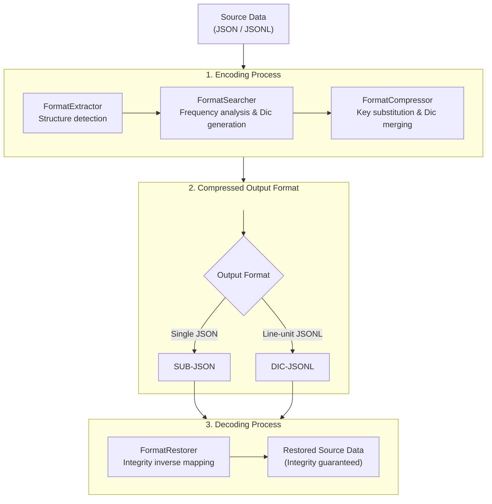
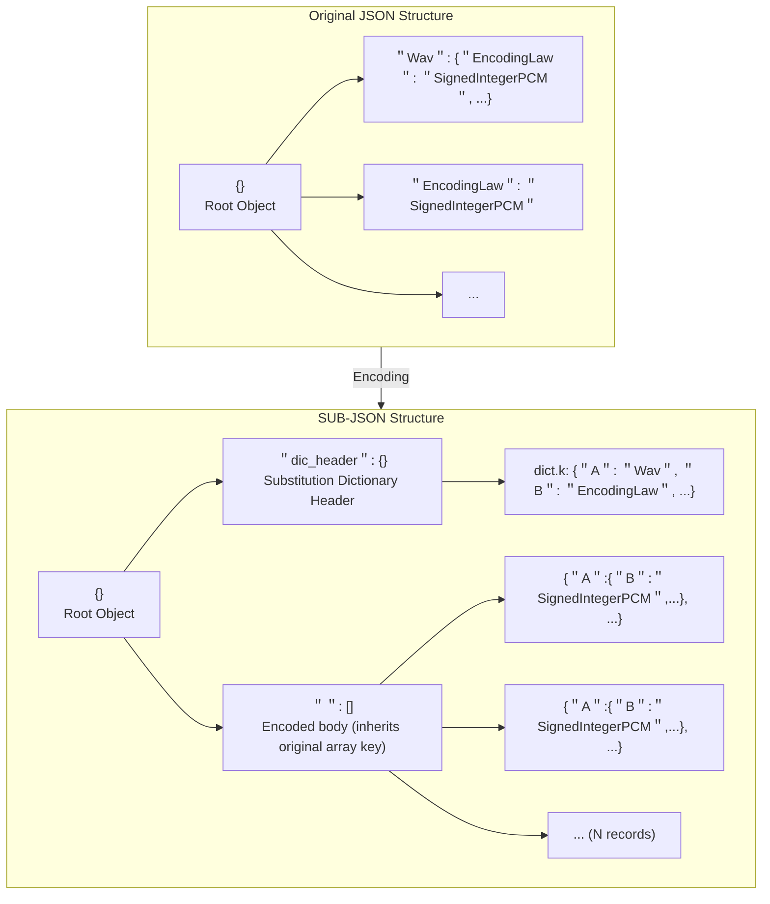
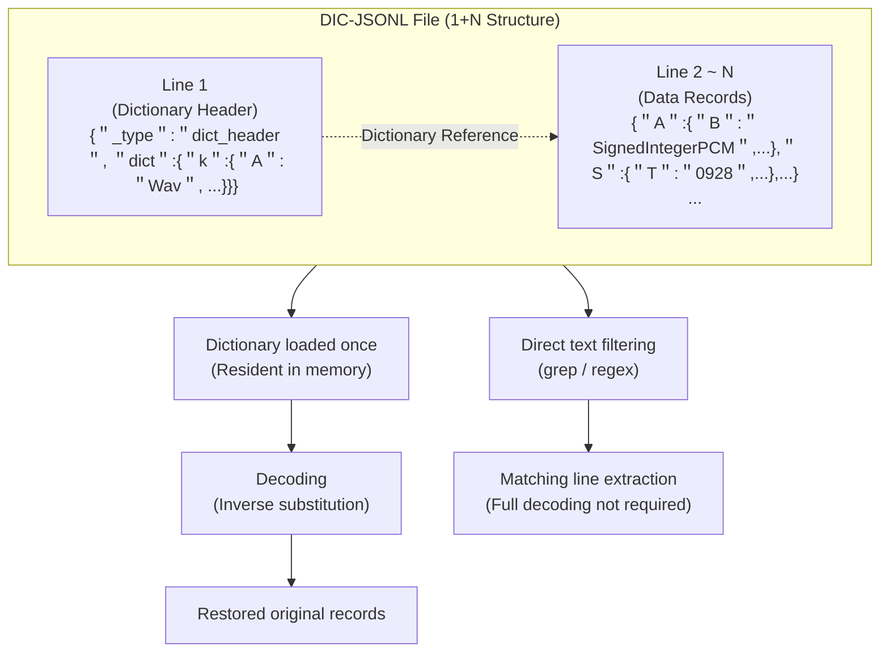

# 적응형 대응코드 시스템을 이용한 JSON/JSONL의 구조 보존 압축 방법

김명환*, 이성만†

## 요약

AI 학습 데이터에 널리 사용되는 JSON/JSONL 파일은 동일한 키 문자열이 레코드에 반복 출현하는 구조적 특성으로 인해 키 문자열이 파일 크기에서 차지하는 비중이 크다. Gzip, Brotli 등 범용 압축은 결과물을 바이너리로 변환하여 표준 JSON 파서로 직접 파싱할 수 없고, 데이터 수정 시 압축 해제 과정이 필요하여 파이프라인 운영에 제약이 발생한다. 본 논문에서는 반복 출현하는 키(key) 문자열을 짧은 대응코드로 치환하고, 코드-원문 매핑 사전을 파일 내에 내장하는 자기완비적 적응형 대응코드 시스템(Adaptive Correspondence Code System)을 제안한다. 제안 시스템은 압축 후에도 JSON 문법과 JSONL의 라인 단위 구문 특성을 유지하여 표준 JSON 파서 기반 파싱과 텍스트 도구 기반 열람을 지원한다. 단, DIC-JSONL은 첫 번째 라인에 사전 헤더를 포함하므로 일반 JSONL 로더에서는 헤더 제외 전처리 또는 전용 디코더가 필요하다. 본 논문은 단일 JSON 객체용 SUB-JSON과 라인 단위 스트리밍용 DIC-JSONL 두 가지 포맷을 제공한다. 감정 태깅 자유대화 데이터(100건~7,000건)와 온라인 구어체 말뭉치 데이터(100건~20,000건) 총 9개 규모 조합에서 라운드트립 무결성 검증을 통과하였으며, DIC-JSONL 기준 파일 크기 축소율은 감정 태깅 데이터에서 평균 48.78%, 구어체 데이터에서 11.52%를 기록하였다. 향후 키 치환 후 범용 압축을 단계적으로 적용하는 파이프라인은 추가적인 압축률 향상 가능성이 있으나, 포맷 접근성 저하, 처리 시간 증가, 디코딩 공정 복잡화가 수반되므로 별도의 비교 연구가 필요하다.

**키워드**: JSON 사전 치환, JSONL, JSON 구조 보존 압축, 적응형 대응코드, AI 학습 데이터

**\* 제1저자**: 서울사이버대학교 인공지능학과 학생 (12600487@iscu.ac.kr)
**† 교신저자**: 서울사이버대학교 빅데이터·정보보호학과 교수 (trex99@iscu.ac.kr)

---

# 1. 서론

인공지능(AI) 기술이 산업 전반에 확산되면서 모델 학습에 필요한 데이터의 규모가 지속적으로 증가하고 있다. JSON(JavaScript Object Notation)은 텍스트 기반 구조, 다양한 언어와의 호환성, 계층적 데이터 표현 능력을 바탕으로 AI 학습 데이터, API 통신, 구성 파일 등에서 표준 포맷으로 자리잡았다[1]. 특히 AI 모델 학습 데이터 포맷으로는 JSON Lines(JSONL)가 널리 사용된다. 각 행이 독립적인 JSON 객체로 완결되는 이 구조는 대규모 언어 모델(LLM) 학습용 말뭉치 구축 연구인 'The Pile'[2] 등에서 채택되었으며, 라인 단위 스트리밍 처리를 지원하여 대용량 데이터셋 전처리에 활용된다.

AI 학습 데이터는 동일한 키 이름이 레코드에 걸쳐 반복 출현하고 각 레코드가 동일한 필드 구조를 가지는 균일한 스키마 형태를 띤다. 예를 들어 감정이 태깅된 자유대화 데이터셋[3]에서는 "SpeakerEmotionCategory", "VerifyEmotionCategory" 등 길이가 긴 키 문자열이 레코드에 걸쳐 반복된다. 이러한 구조적 반복성은 키 문자열 자체가 파일 크기에서 차지하는 비중이 크다는 것을 의미한다. Gzip, Brotli 등 범용 압축은 압축률 극대화를 목표로 하며, 결과물을 바이너리 형식으로 변환한다. 따라서 표준 JSON 파서나 텍스트 편집기로 원본 JSON 구조를 열람하거나 편집할 수 없으며, 데이터를 검증하거나 수정하려면 압축 해제·수정·재압축의 공정을 수반하여 전체 데이터 파이프라인의 운영 효율을 떨어뜨린다. 반면 본 연구에서 제안하는 방법은 키를 짧은 대응코드로 치환한 후에도 결과물이 표준 JSON 문법을 유지하므로, 기존 파서나 텍스트 도구를 그대로 사용할 수 있다.

본 연구에서는 반복 출현하는 키를 짧은 대응코드로 치환하고, 코드-원문 매핑 사전을 동일 파일 내에 내장하는 자기완비적 적응형 대응코드 시스템(Adaptive Correspondence Code System)을 제안한다. 두 가지 포맷 변형을 제공하며, SUB-JSON은 단일 JSON 객체에 적합하고, DIC-JSONL은 대규모 데이터셋을 대상으로 JSONL 포맷을 유지하면서 라인 단위 스트리밍 처리를 가능하게 한다. 제안 방법은 표준 포맷 유지, 내장 사전을 통한 스트리밍 처리, 충돌 회피를 포함한 결정론적 재현성이라는 세 가지 요건을 동시에 충족하는 것을 설계 목표로 한다.

---

# 2. 관련 연구

## 2.1 JSON 포맷과 기존 압축 기법의 한계

BSON[7], MessagePack[8], CBOR[9]과 같은 바이너리 직렬화(binary serialization) 포맷들은 데이터 타입과 구조 정보를 바이너리 코드로 인코딩하여 파일 크기를 줄이고 파싱 속도를 향상시켰으나, 원본 텍스트 구조에 접근하여 표준 JSON 파서로 직접 파싱하는 것이 불가능하다.

사전 기반 압축(Dictionary-based compression) 기법인 Lempel-Ziv 계열 알고리즘(LZ77, LZ78, LZW 등)[18][19]은 반복되는 문자열 패턴을 짧은 인덱스나 포인터로 치환한다는 점에서 본 연구와 원리상 유사하다. 그러나 범용 압축을 목적으로 하는 이 알고리즘들은 압축 데이터를 바이너리 블록으로 출력하므로, 표준 JSON 파서로의 직접 파싱이 불가능하다.

텍스트 기반 포맷의 구조를 유지하면서 압축을 수행하려는 연구로는 스키마 기반 압축(Schema-based compression) 기법이 있다. 이는 JSON Schema[10]를 별도 문서로 분리 정의하고, 본문에서는 반복되는 키를 생략한 채 값만 배열 형태로 나열하는 방식이다. 그러나 외부 스키마 파일에 구조 해석을 의존하므로 자기완비적 운용이 어렵다.

JSON 키 치환과 사전 저장을 조합한 구현 사례로 Laslop(2020)[16]과 Objelean(2011)[17]이 있으나, 두 방식 모두 결과물이 표준 JSON 문법을 유지하지 않거나 라인 단위 스트리밍을 지원하지 않아, 표준 포맷 유지·내장 사전을 통한 스트리밍 처리·충돌 회피를 포함한 결정론적 재현성이라는 세 가지 요건을 동시에 충족하지 못한다. 본 연구는 이 세 가지 요건을 동시에 충족하는 방식으로 JSON/JSONL에 적용하는 것을 목표로 한다.

## 2.2 AI 학습 데이터 처리 체계의 동향

대규모 언어 모델(LLM)의 발전으로 테라바이트 단위 이상의 텍스트 데이터셋을 다루는 환경이 널리 활용되고 있다. 파일 전송 속도 및 디스크 입출력 성능이 전체 파이프라인의 병목 지점이 됨에 따라, Apache Parquet, Apache Arrow와 같은 컬럼 기반 저장소(Columnar Format) 및 인메모리(in-memory) 분석 포맷이 딥러닝 프레임워크와의 연동에 채택되고 있다[11]. 그러나 데이터의 수집, 정제, 전처리 단계 등 파이프라인의 초기 영역에서는 여전히 JSON 및 JSONL이 표준 인터페이스 역할을 담당한다. 예를 들어, NVIDIA NeMo Curator[12]는 JSONL을 기본 입력 포맷으로 사용한다. 이러한 배경에서, 텍스트 구조와 JSON 파서 호환성을 유지하면서 반복 키 문자열을 짧은 식별자로 축약하는 방법이 요구된다.

---

# 3. 제안 방법

본 장에서는 적응형 대응코드(Adaptive Correspondence Code) 기반의 데이터 압축 방법의 시스템 아키텍처와 핵심 설계를 설명한다. 또한 본 기법을 단일 JSON에 적용한 SUB-JSON(Substituted JSON) 포맷과, 라인 단위 스트리밍을 지원하는 DIC-JSONL(Dictionary-based JSON Lines) 포맷의 구성 원리를 각각 설명한다.

## 3.1 적응형 대응코드 시스템 아키텍처

시스템의 처리 파이프라인은 네 개의 모듈로 구성된다.

첫째, 포맷추출부(FormatExtractor)이다. 입력 데이터를 순회하며 JSON 객체의 구조를 검출한다. 둘째, 포맷서치부(FormatSearcher)이다. 추출된 데이터에서 키의 출현 빈도와 문자열 길이를 집계하고, 키 $k_i$는 출현 빈도 $f_i \geq \theta_f$를 만족하고 $L_{key,i} - L_{code,i} > 0$인 경우에만 대응코드 사전에 등록한다. 여기서 $\theta_f$는 빈도 임계값으로, 사전 헤더 오버헤드와 치환 절감량 간의 균형을 조정한다. 셋째, 포맷압축부(FormatCompressor)이다. 생성된 사전을 이용해 원본 데이터의 키를 대응코드로 치환하고, 사전 정보와 인코딩된 본문 데이터를 결합하여 출력 포맷에 따라 SUB-JSON 또는 DIC-JSONL 파일을 생성한다. 넷째, 포맷복원부(FormatRestorer)이다. 파일에 내장된 사전을 참조하여 대응코드를 원문 문자열로 역매핑함으로써 키-값 무결성을 보장하는 복원을 수행한다.

본 연구는 키(key) 치환만을 핵심 압축 수단으로 채택하였다. 값(value) 문자열은 엔트로피가 높고 변동성이 커서 치환 시 사전 규모가 비대해질 수 있는 반면, 키는 데이터의 스키마를 형성하는 높은 반복성을 갖는 문자열이므로 접두사 기반 치환으로 구조적 중복을 제거한다[13][14].

대응코드의 설계 핵심은 제3.2절에서 기술하는 결정론적 순차 할당 절차에 있다. 대응코드는 JSON 키 명명 규칙에 위배되지 않는 범위 내에서 중복 없이 순차 증가하도록 할당된다. 개념 설명에서는 k1, k2와 같이 키-코드 대응 관계를 나타내는 기호를 사용하며, 본 실험에서는 압축 효율을 위해 알파벳 단일 문자부터 순차 할당하는 알파뉴메릭 시리얼 코드 방식(A, B, C, …)을 채택하였다.


**Fig. 1** 적응형 대응코드 시스템 처리 파이프라인 아키텍처

## 3.2 결정론적 대응코드 할당 절차

대응코드 할당의 핵심 문제는 생성하려는 코드가 원본 데이터 내 기존 키 문자열 및 이미 사전에 등록된 코드와 충돌하지 않도록 보장하는 것이다. 이를 위해 본 연구는 해시 테이블의 개방 주소법(Open Addressing)에서 확립된 선형 탐사(Linear Probing)의 순차 후보 탐색 원리[6]를 단순화하여, 해시 함수 없이 인덱스 $i$를 1부터 순차 증가시키는 카운터 방식을 적용하였다.

후보 코드 $c_i$는 알파벳 대소문자를 기반으로 한 알파뉴메릭 시리얼 함수로 정의된다 ($c_i = \text{serial}(i)$, $i \in \mathbb{Z}^+$). RFC 8259 §7에 따르면 JSON 키는 유효한 유니코드 문자열이면 원칙적으로 모두 허용되나[1], 본 연구에서는 코드 생성 로직의 단순화와 JSON 구조 문자(`{`, `}`, `:`, `"` 등)와의 혼동 방지를 위해 알파벳 대소문자(A–Z, a–z)로 구성된 알파뉴메릭 시리얼 코드를 채택하였다. 코드는 단일 알파벳 문자(1바이트, $i = 1 \sim 52$)를 우선 할당하고, 이후 두 문자 조합(2바이트, $i \geq 53$) 순으로 순차 확장된다. 시스템은 $i = 1$부터 순차적으로 탐색하여, 생성된 후보 코드 $c_i$가 다음 조건을 만족하는 최소의 $i$를 선택한다.

$$i^* = \min \{ i \in \mathbb{Z}^+ \mid c_i \notin D_{org} \text{ 이고 } c_i \notin \text{keys}(\mathcal{D}) \}$$

단, $D_{org}$는 원본 데이터 내의 전체 고유 키 문자열 집합이며, $\mathcal{D}$는 해당 시점까지 구축된 대응코드 사전이다. 이미 할당된 코드는 사전 $\mathcal{D}$의 키로 관리되므로 별도의 집합 없이 사전 조회만으로 중복을 방지할 수 있다.

코드 할당 순서는 **1차 순회에서 기록한 키의 첫 등장 순서**를 기준으로 한다. 1차 순회 완료 후 전체 고유 키 집합 $D_{org}$가 확정되면, 치환 대상 키를 첫 등장 순서대로 처리하면서 원본 키 및 이미 할당된 코드와 충돌하지 않는 최소 대응코드를 순차적으로 부여한다. 이 순서 규칙이 동일 입력에 대해 동일한 사전을 생성하는 결정론적 재현성의 핵심 근거이다. 충돌이 발생하면 인덱스를 순차적으로 증가시켜 다음 후보를 탐색하므로, 원본 데이터에 후보 코드와 동일한 키 문자열이 이미 존재하는 경우 해당 코드를 건너뛰고 다음 인덱스의 코드를 결정론적으로 선택한다. 예를 들어 원본 데이터에 `A`라는 키가 존재하면 다음 후보인 `B`를 할당한다.

탐사 절차에서 단일 코드 탐사 연산의 시간 복잡도는 충돌이 없는 경우 $O(1)$이며, 충돌 발생 시에는 충돌 횟수 $c$에 대해 $O(c)$이다. 실제 AI 학습 데이터에서 원본 키와 생성 코드가 충돌하는 경우는 드물어 $c$는 무시 가능한 수준이다. 사전 $\mathcal{D}$는 dict(해시맵) 자료구조로 운용되므로 각 키 치환 조회도 $O(1)$이며, 전체 인코딩 파이프라인의 복잡도는 레코드 수 $N$에 대해 $O(N)$이다. 실제 AI 학습 데이터에서 치환 대상 키의 수는 데이터셋 규모와 무관하게 스키마에 의해 고정되므로 $|\mathcal{D}|$는 상수에 수렴한다. 본 실험에서 감정 태깅 데이터는 레코드 수(100건~7,000건)와 무관하게 $|\mathcal{D}| = 47$이, 구어체 데이터는 레코드 수(100건~20,000건)와 무관하게 $|\mathcal{D}| = 13$이 일관되게 유지된 결과는 이러한 특성과 일치한다.

## 3.3 압축 분석 공식

본 방법은 $L_{key,i} - L_{code,i} > 0$을 만족하는 치환 대상 키의 집합 $\mathcal{K}$를 정의한다. $\mathcal{K}$에 속하는 각 키의 문서 전체 출현 횟수를 $f_i$라 할 때, 치환으로 절감되는 총 바이트 수 $\Delta B$는 다음 근사식으로 표현된다.

$$\Delta B \approx \sum_{i \in \mathcal{K}} f_i \cdot (L_{key,i} - L_{code,i})$$

여기서 $L_{key,i}$와 $L_{code,i}$는 각각 원본 키 $i$와 대응코드 $i$를 JSON 직렬화한 후 UTF-8 기준 이스케이프 처리된 키 이름 문자열의 바이트 길이이고, $N_{key} = |\mathcal{K}|$는 치환 대상 키의 수이다. 본 실험 데이터의 키는 ASCII 기반이므로 문자 수와 UTF-8 바이트 수가 동일하다. $f_i$는 JSON 구조의 중첩 깊이나 스키마 형태와 무관하게 실제 출현 횟수를 직접 반영하므로, 단일 레벨 스키마와 계층적 스키마를 구분 없이 동일한 공식으로 다룰 수 있다. 본 근사식은 순수 키 문자열 치환에 의한 절감량만을 나타내며, 사전 헤더 오버헤드 및 JSON 포맷 구조 기호의 처리에 따른 변동분은 포함하지 않는다. $\Delta B$ 근사식 산출값과 실측 절감량의 비교 결과는 4.5절에서 제시한다.

## 3.4 SUB-JSON: 단일 객체 지향형 구조 압축 포맷

SUB-JSON은 일반적인 JSON 데이터에 적응형 대응코드를 적용하기 위해 고안된 포맷이다. 파일의 루트 계층은 `"dic_header"` 필드(사전 헤더)와 원본 배열 데이터 필드로 구성된다. `"dic_header"` 영역은 인코더가 생성한 사전으로, 치환 코드와 원본 키의 1:1 매핑을 저장하며, 데이터 배열 영역에는 키가 대응코드로 치환된 본문이 위치한다. 배열 필드명은 원본 JSON의 배열 키를 그대로 승계한다(부록 A.1 참조).


**Fig. 2** SUB-JSON 포맷 구조: 원본 JSON에서 치환 사전 내장형 단일 객체로의 변환 (배열 키는 원본 JSON의 배열 키를 승계한 예시)

SUB-JSON은 일반 텍스트 편집기나 표준 JSON 파서로 직접 열람하고 파싱할 수 있다. 다만, 대규모 데이터에는 DIC-JSONL 사용을 권장한다.

## 3.5 DIC-JSONL: 스트리밍 라인 단위 압축 포맷

DIC-JSONL(Dictionary-based JSON Lines) 포맷은 대규모 데이터 파이프라인에서 요구되는 라인 단위 스트리밍(streaming) 처리를 지원하면서 사전을 자기완비적으로 내장하기 위해 제안되었다. 사전 정보를 단일 JSON 객체 형태로 배치하고, 이후 라인부터 대응코드로 치환된 데이터 객체들을 차례로 나열하는 1+N 구조를 채택하였다. DIC-JSONL은 각 라인이 독립적으로 파싱 가능한 JSON 객체라는 JSONL의 라인 단위 구문적 특성을 유지한다. 디코더는 사전 헤더를 식별하여 메모리에 적재하고, 이후 라인들에 역치환을 적용한다(본 연구에서는 `"_type":"dict_header"` 필드로 사전 헤더를 식별한다). 따라서 균질한 데이터 레코드만을 기대하는 일반 JSONL 로더에서는 전처리 또는 전용 디코더가 필요하다.

```json
{"_type":"dict_header","version":1,"dict":{"k":{"A":"Wav","B":"EncodingLaw",...}}}
```

디코딩 시에는 Line 1의 사전을 메모리에 1회 적재한 후, 이어지는 라인들을 스트리밍 방식으로 순차 역치환하므로 메모리 사용량이 레코드 수 증가율에 비례하지 않고 완만하게 증가하는 특성을 갖는다. DIC-JSONL은 치환 후에도 결과물이 평문 텍스트 형태를 유지하므로, 압축 상태에서도 정규식이나 키워드 검색을 통해 조건을 만족하는 라인을 추출할 수 있다. 다만 키 문자열은 대응코드로 치환된 상태이므로, 값 문자열에 대한 키워드 검색은 직접 가능하며 키 조건 검색은 내장 사전을 참조하여 원본 키를 대응코드로 변환한 뒤 수행할 수 있다.

DIC-JSONL의 인코딩은 2-pass streaming 방식으로 수행된다. 1차 순회에서는 입력 JSONL 전체를 라인 단위로 읽으면서 원본 전체 고유 키 집합 $D_{org}$, 키별 출현 빈도 $f_i$, 키 길이, 첫 등장 순서를 수집한다. 1차 순회가 완료되면 $D_{org}$와 치환 대상 키 집합 $\mathcal{K}$를 기준으로 원본 키 및 기존 코드와 충돌하지 않는 대응코드 사전 $\mathcal{D}$를 확정한다. 2차 순회에서는 완성된 사전을 첫 번째 라인에 헤더로 출력한 뒤, 이어지는 각 데이터 레코드의 키를 대응코드로 치환하여 라인 단위로 출력한다. 이 방식은 입력 파일을 재순회할 수 있는 환경을 전제로 한다. 디코딩은 첫 번째 라인의 사전을 1회 적재한 후 이어지는 라인을 순차 역치환하는 1-pass streaming 방식이다.


**Fig. 3** DIC-JSONL 포맷의 1+N 구조 및 스트리밍 처리 흐름

---

# 4. 실험 결과

본 실험은 구현된 방법의 구조 보존, 복원 무결성, 파일 크기 절감, 스트리밍 특성 보존을 동일 조건에서 측정 가능하도록 설계하였다.

## 4.1 실험 환경 및 데이터셋 구성

실험은 Windows 11 Pro, Intel Core i7-1260P(12코어 16스레드, 기본 클럭 2.10GHz), 32GB RAM, NVMe SSD 환경에서 수행하였으며, 실행 인터프리터는 Python 3.12.12이다.

실험에는 두 가지 AI 허브 대화 말뭉치 계열 샘플을 사용하였다. 첫 번째는 감정이 태깅된 자유대화 청소년 TL 01 실내(이하 감정 태깅 데이터)[3]이며, 동일 스키마를 갖는 JSON 레코드가 반복되는 전형적인 학습 데이터 형태를 가진다. 두 번째는 온라인 구어체 말뭉치 데이터[15]로, 게시글 본문과 댓글 구조를 포함하는 계층적 말뭉치 데이터이다. 두 데이터셋은 구조적 복잡성과 키 문자열 길이 측면에서 서로 다른 특성을 지니며, 이를 비교함으로써 본 방법의 압축 효율에 영향을 미치는 요인을 분석할 수 있다.

각 규모 실험은 원본 파일 순서 기준 첫 N개 레코드를 사용하였으며, 별도 랜덤 샘플링은 수행하지 않았다. 감정 태깅 데이터의 실험 레코드 수는 100, 1,000, 5,000, 7,000건이며, 각 원본 파일 크기는 각각 8.97MB, 94.77MB, 506.06MB, 754.44MB이다. 20,000건 규모의 실험은 AI 허브에서 제공하는 해당 데이터셋의 전체 분량 제약으로 인해 수행하지 않았다. 구어체 데이터의 실험 레코드 수는 100, 1,000, 5,000, 7,000, 20,000건이며, 각 원본 파일 크기는 1.37MB, 48.63MB, 441.82MB, 501.02MB, 1,399.57MB이다. 메모리 사용량은 OS 환경 변동을 고려하여 5회 측정한 평균값(tracemalloc 피크 메모리 기준)을 사용하였다.

## 4.2 구조 보존 및 방법별 성능 비교

Gzip 압축 결과는 이진 데이터로 변환되어 표준 JSON 파서나 텍스트 편집기로 직접 읽을 수 없는 반면, JSONL_Encoder의 결과는 키가 대응코드로 치환되었음에도 각 라인이 JSON 객체로 파싱 가능한 JSONL 계열 텍스트 형식을 유지하므로, 표준 JSON 파서와 텍스트 편집기를 통한 라인별 열람·파싱이 가능하다. 다만 첫 번째 라인은 사전 헤더이므로, 일반 JSONL 로더에서 학습 레코드로 직접 사용하려면 헤더 제외 전처리 또는 전용 디코더가 필요하다. Table 1은 동일한 JSON 데이터에 대해 원본, Gzip, 제안 방법의 출력 형태를 비교한 것이다.


**Fig. 4.** JSONL_Encoder(텍스트 출력) vs Gzip(이진 출력) 포맷 비교

**Table 1** 원본·Gzip·제안 방법의 출력 형태 비교

| 상태 | 파일 내용 (일부) | 표준 JSON 파서 파싱 가능 여부 |
|---|---|---|
| 원본 JSON | `{"SpeakerEmotionCategory": "긍정", "Text": "..."}` | 가능 |
| Gzip 압축 후 | `1f 8b 08 00 00 00 00 00 00 03 ...` (바이너리) | 불가 |
| 제안 방법 적용 후 | `{"A": "긍정", "B": "..."}` (유효한 JSON) | 가능 |

**Table 2** 구조 보존 여부 비교

| 방법                          | 표준 JSON 파서 파싱 | 텍스트 편집기 열람 | 사전을 통한 원문 복원        |
| --------------------------- | ------------- | ---------- | ------------------- |
| 원본 JSON/JSONL               | 가능            | 가능         | 해당 없음               |
| Gzip 압축                     | 불가            | 불가         | 불가 (JSON 포맷 소멸)     |
| 본 방법 (SUB-JSON, DIC-JSONL) | 가능            | 가능         | 가능 (내장 사전 참조)       |

인코딩 및 디코딩 시간은 5회 측정 평균값이며, 메모리는 tracemalloc 피크 메모리 기준이다.

**Table 2-2** 포맷·방법별 특성 정량 비교 (감정 태깅 데이터, 7,000건 기준)

| 방법 | 텍스트 열람 | JSON 직접 파싱 | 압축률(%) | 인코딩 시간(s) | 인코딩 메모리(MB) | 디코딩 시간(s) | 디코딩 메모리(MB) |
|---|---|---|---|---|---|---|---|
| **[JSON]** | | | | | | | |
| 원본 JSON | 가능 | 가능 | 0 | — | — | — | — |
| Minified JSON | 가능 | 가능 | ~0.0 | 111.0 | 1,759.3 | 59.3 | 2,292.8 |
| Gzip (JSON) | 불가 | 불가 | 91.25 | 12.0 | 898.2 | 3.6 | 1,509.1 |
| Brotli q=4 (JSON) | 불가 | 불가 | 92.38 | 7.2 | 869.6 | 2.2 | 812.1 |
| SUB-JSON (본 방법) | 가능 | 가능 | 48.73 | 186.8 | 2,794.9 | 78.7 | 7,833.1 |
| SUB-JSON + Gzip | 불가 | 불가 | 92.18 | 345.6 | 5,087.6 | 77.6 | 8,431.0 |
| SUB-JSON + Brotli q=4 | 불가 | 불가 | 92.99 | 400.5 | 5,087.6 | 73.5 | 8,431.0 |
| **[JSONL]** | | | | | | | |
| 원본 JSONL | 가능 | 가능 | 0 | — | — | — | — |
| Minified JSONL | 가능 | 가능 | ~0.0 | 217.7 | 2,667.1 | 61.4 | 3,642.9 |
| Gzip (JSONL) | 불가 | 불가 | 91.25 | 12.0 | 898.2 | 3.6 | 1,509.1 |
| Brotli q=4 (JSONL) | 불가 | 불가 | 92.38 | 7.2 | 869.6 | 2.2 | 812.1 |
| DIC-JSONL (본 방법) | 가능 | 가능 | 48.73 | 376.1 | 7.2 | 144.4 | 8.8 |
| DIC-JSONL + Gzip | 불가 | 불가 | 92.18 | 440.4 | 523.6 | 108.2 | 773.7 |
| DIC-JSONL + Brotli q=4 | 불가 | 불가 | 92.99 | 345.5 | 492.7 | 117.7 | 439.7 |

## 4.3 무결성 및 결정론성 검증

인코딩 전 원본 데이터와 복원된 데이터의 라운드트립 검증을 수행하였다. JSON 객체는 키 순서가 구현마다 다를 수 있으므로, 키를 사전순으로 정렬한 직렬화 문자열로 비교하여 논리적 동일성을 검증하였으며, 중첩 계층 구조 전체에 걸쳐 배열 원소의 순서·값까지 포함하여 검증한다.

그 결과, 감정 태깅 데이터(100건, 1,000건, 5,000건, 7,000건)와 구어체 데이터(100건, 1,000건, 5,000건, 7,000건, 20,000건) 전체 조합에서 JSON_Encoder와 JSONL_Encoder가 각각 모든 무결성 검증을 통과하였다. 또한 레코드 수와 무관하게 치환 키 수가 일관되게 유지되어 결정론성이 확인되었다. 이는 3.2절에서 정의한 첫 등장 순서 기준의 순차 할당 절차에 의해 동일 입력에 대해 항상 동일한 코드가 생성되는 결정론적 특성에서 비롯된다.

**Table 3** 라운드트립 무결성 검증 결과 (검증 방법: 키 정렬 직렬화 비교)

| 데이터셋 | 레코드 수 | `JSON_Encoder` | `JSONL_Encoder` |
|---|---|---|---|
| 감정 태깅 | 100 | PASS | PASS |
| 감정 태깅 | 1,000 | PASS | PASS |
| 감정 태깅 | 5,000 | PASS | PASS |
| 감정 태깅 | 7,000 | PASS | PASS |
| 구어체 | 100 | PASS | PASS |
| 구어체 | 1,000 | PASS | PASS |
| 구어체 | 5,000 | PASS | PASS |
| 구어체 | 7,000 | PASS | PASS |
| 구어체 | 20,000 | PASS | PASS |
| **합계** | | **9/9 PASS** | **9/9 PASS** |

**Table 4** 레코드 크기별 키 치환 수 (결정론성 확인)

| 방법 | 데이터셋 | 100건 | 1,000건 | 5,000건 | 7,000건 | 20,000건 |
| --- | --- | --- | --- | --- | --- | --- |
| `JSON_Encoder` | 감정 태깅 | 47 | 47 | 47 | 47 | — |
| `JSONL_Encoder` | 감정 태깅 | 47 | 47 | 47 | 47 | — |
| `JSON_Encoder` | 구어체 | 13 | 13 | 13 | 13 | 13 |
| `JSONL_Encoder` | 구어체 | 13 | 13 | 13 | 13 | 13 |

※ 감정 태깅 데이터의 20,000건 (`—`): 해당 데이터셋의 전체 분량이 7,828건이어서 20,000건 규모의 실험은 수행하지 않았다.

## 4.4 메모리 사용량 분석

DIC-JSONL(JSONL_Encoder)이 원본 JSONL의 스트리밍 특성을 인코딩과 디코딩 양방향에서 유지하는지 검증하기 위해 tracemalloc 피크 메모리를 측정하였다.

**Table 5** 레코드 수별 인코딩·디코딩 피크 메모리 (감정 태깅 데이터 기준, 단위: MB)

| 레코드 수 | JSON_Encoder 인코딩 | JSONL_Encoder 인코딩 | JSONL_Encoder 디코딩 |
|---|---|---|---|
| 100 | 35.12 | 3.42 | 2.80 |
| 1,000 | 351.15 | 5.41 | 6.11 |
| 5,000 | 2,044.20 | 7.21 | 8.47 |
| 7,000 | 2,794.89 | 7.21 | 8.83 |

JSONL_Encoder(DIC-JSONL)는 레코드 수가 100건에서 7,000건으로 70배 증가하는 동안 인코딩 메모리는 약 2.1배(3.42 MB → 7.21 MB), 디코딩 메모리는 약 3.2배(2.80 MB → 8.83 MB) 증가에 그쳤으며, 5,000건과 7,000건에서 동일한 값(7.21 MB)이 측정되어 포화 양상이 확인됨으로써 JSONL의 스트리밍 특성이 인코딩 후에도 유지됨이 실험적으로 확인되었다. 이는 1+N 구조에서 라인 단위로 순차 처리하기 때문이다. 반면 JSON_Encoder(SUB-JSON)는 전체 파일을 메모리에 적재하는 구조 특성상 레코드 수에 비례하여 선형 증가한다.

## 4.5 파일 크기 절감 분석

본 절에서는 키 치환으로 발생하는 구조적 파일 크기 절감을 측정한다.

**Table 6** 데이터셋별 평균 파일 크기 절감률

| 데이터셋 | JSON_Encoder (SUB-JSON) | JSONL_Encoder (DIC-JSONL) |
| --- | --- | --- |
| 감정 태깅 데이터 | 48.79% | 48.78% |
| 온라인 구어체 데이터 | 11.53% | 11.52% |

※ 가독성용 공백(들여쓰기, 줄바꿈 등)은 데이터 생성 방식에 따라 상이하므로 측정 대상에서 제외

감정 태깅 데이터에서 JSONL_Encoder의 평균 파일 크기 절감률은 48.78%이며, 데이터 크기가 증가해도 48.67%에서 49.05% 범위에서 유지되었다. 구어체 데이터에서는 동일 방법으로 평균 11.52%를 기록하였으며, 절감률은 7.75%에서 12.70% 범위로 나타났다. 100건에서 7.75%로 상대적으로 낮은 것은 320바이트의 헤더 오버헤드가 소규모 파일(1.37MB)에서 차지하는 비중이 크기 때문이며, 레코드 수가 증가할수록 12% 후반대에 근접하는 경향을 보였다.

3.3절의 $\Delta B$ 근사식 산출값과 실측 절감량을 직접 비교하여, 근사식이 실험 결과를 이론적으로 얼마나 잘 설명하는지 확인하였다. 감정 태깅 데이터의 경우 $N_{key}=47$, $\overline{L_{key}}=11.5532$바이트, $\overline{L_{code}}=1$바이트이며, 구어체 데이터의 경우 $N_{key}=13$, $\overline{L_{key}}=6.9231$바이트, $\overline{L_{code}}=1$바이트이다.

**Table 7** 두 데이터셋의 구조적 특성 비교

| 특성 | 감정이 태깅된 자유대화 청소년 | 온라인 구어체 말뭉치 |
|---|---|---|
| 고유 키 수 ($N_{key}$) | 47개 | 13개 |
| 평균 키 길이 ($\overline{L_{key}}$) | 11.5532바이트 | 6.9231바이트 |
| 평균 코드 길이 ($\overline{L_{code}}$) | 1바이트 | 1바이트 |
| 최장 키 길이 | 22바이트 (`SpeakerEmotionCategory`) | 11바이트 (`source_file`) |
| 최대 중첩 깊이 | 2 | 3 |
| JSONL_Encoder 평균 압축률 | 48.78% | 11.52% |

**Table 8** $\Delta B$ 근사식 산출값 vs 실측 절감량 비교

| 데이터셋 | 레코드 수 | $\Delta B$ 근사식 (bytes) | 실측 절감 (bytes) | 오차율 (%) |
|---|---|---|---|---|
| 감정 태깅 | 100 | 4,616,560 | 4,615,649 | +0.0097 |
| 감정 태깅 | 1,000 | 48,374,020 | 48,374,009 | +0.0000 |
| 감정 태깅 | 5,000 | 258,272,960 | 258,275,938 | -0.0006 |
| 감정 태깅 | 7,000 | 385,510,120 | 385,512,065 | -0.0002 |
| 구어체 | 100 | 111,758 | 111,538 | +0.0153 |
| 구어체 | 1,000 | 6,085,181 | 6,085,861 | -0.0013 |
| 구어체 | 5,000 | 58,826,031 | 58,830,711 | -0.0010 |
| 구어체 | 7,000 | 66,344,574 | 66,351,254 | -0.0013 |
| 구어체 | 20,000 | 185,054,278 | 185,073,958 | -0.0013 |

오차율의 절댓값은 전체 9개 조합에서 최대 0.0153%, 평균 0.0033% 수준으로, 원본 파일 크기 대비 무시 가능한 범위이다. 소규모 파일(100건)에서 산출값이 실측보다 큰 것은 근사식이 사전 헤더 오버헤드를 포함하지 않아 실측 절감량이 헤더 비용만큼 줄어든 데서 비롯되며, 대규모 파일에서 산출값이 실측보다 작은 것은 가독성용 공백·개행 문자의 처리 차이에서 비롯된다.

두 데이터셋 간 절감률 차이의 주된 원인은 구조적 복잡성이 아닌 키 문자열의 평균 길이와 고유 키 수 차이에 있다. 제안 방법은 원본 키를 짧은 대응코드로 치환하므로, 치환으로 절감되는 바이트 수는 ($L_{key,i} - L_{code,i}$)에 비례한다. 감정 태깅 데이터는 $\overline{L_{key}} = 11.5532$바이트로 치환 한 번당 평균 약 10.55바이트가 절감되는 반면, 구어체 데이터의 $\overline{L_{key}} = 6.9231$바이트에서는 치환 한 번당 평균 약 5.92바이트 절감에 그쳐 치환 효과가 제한된다. 또한 감정 태깅 데이터는 47개의 고유 키가 레코드마다 반복 출현하는 데 비해, 구어체 데이터는 13개의 키만이 치환 대상이므로 전체 파일에서 키 문자열이 차지하는 비중 자체가 작다. 구어체 데이터는 최대 중첩 깊이 3으로 감정 태깅 데이터보다 구조적으로 복잡하나, $\Delta B$ 근사식은 실제 키 출현 횟수 $f_i$를 직접 집계하므로 압축 효율 차이는 중첩 깊이가 아닌 $N_{key}$와 $\overline{L_{key}}$에 의해 설명되며, Table 8의 수치로 실증되었다.

---

# 5. 결론 및 향후 연구

본 연구에서는 반복 출현하는 키를 짧은 대응코드로 치환하고 매핑 사전을 동일 파일 내에 자기완비적으로 내장하는 JSON/JSONL 구조 보존 압축 방법을 구현하고 실험하였다.

실험을 통해 세 가지 결과를 확인하였다. 첫째, 인코딩 이후에도 출력 결과가 JSON 문법과 JSONL의 라인 단위 구문 특성을 유지하여 표준 JSON 파서 기반의 객체/라인별 파싱과 텍스트 편집기 기반 열람이 가능함을 확인하였다. 다만 DIC-JSONL의 첫 번째 라인은 사전 헤더이므로, 일반 JSONL 로더에서 데이터 레코드로 직접 사용하려면 헤더 제외 전처리 또는 전용 디코딩 절차가 필요하다. 둘째, 두 데이터셋 9개 규모 조합 전체에서 라운드트립 무결성 검증을 통과하였으며, JSONL_Encoder(DIC-JSONL) 기준 파일 크기 절감률은 감정 태깅 데이터에서 평균 48.78%, 구어체 데이터에서 평균 11.52%로 측정되었고, 고유 키 수와 키의 길이가 압축률을 결정하는 주요 인자임을 확인하였다. 셋째, $\Delta B$ 근사식 산출값이 두 데이터셋 모두에서 최대 오차율 0.0153%였다.

향후 연구 방향으로는 하이브리드 방식에 대한 분석을 제시한다. 제안 방법은 포맷 구조 유지를 설계 목표로 하므로, 비트 수준의 압축을 수행하는 범용 바이너리 압축기와 비교하여 최종 압축률에서 낮은 수치를 보인다. 이는 설계 목표의 차이에서 비롯된 것으로, 제안 방법은 텍스트 호환성을 유지하는 범위 안에서 구조적 중복을 선행 제거하는 역할을 담당한다. 적응형 대응코드 적용 후 범용 바이너리 압축을 추가로 적용하는 하이브리드 방식은 최종 출력이 바이너리로 변환되어 포맷 구조가 소멸하므로 본 연구의 핵심 목적 범위 밖에 해당하지만, Table 2-2에서 확인한 바와 같이 DIC-JSONL에 Gzip 또는 Brotli를 추가 적용하면 92.18~92.99%의 압축률을 달성할 수 있으나, 이는 범용 압축기 단독 적용(91.25~92.38%) 대비 0.61~0.93%p의 추가 향상에 해당한다. 단계적 압축 파이프라인은 추가적인 압축률 향상을 가져올 가능성이 있으나, 포맷 접근성 저하, 처리 시간 증가, 디코딩 공정 복잡화가 함께 발생할 수 있으므로 별도의 비교 연구가 필요하다.

---

## 참고문헌

[1] Bray, T. (Ed.). (2017). The JavaScript Object Notation (JSON) Data Interchange Format. IETF RFC 8259. https://datatracker.ietf.org/doc/html/rfc8259

[2] Leo Gao, Stella Biderman, Sid Black, Laurence Golding, Travis Hoppe, Charles Foster, Jason Phang, Horace He, Anish Thite, Noa Nabeshima, Shawn Presser, Connor Leahy. (2020). The Pile: An 800GB Dataset of Diverse Text for Language Modeling. arXiv preprint arXiv:2101.00027. https://arxiv.org/abs/2101.00027

[3] 한국지능정보사회진흥원(NIA). 감정이 태깅된 자유대화(134-2). AI Hub. https://www.aihub.or.kr

[4] Deutsch, P. (1996). GZIP file format specification version 4.3. IETF RFC 1952. https://datatracker.ietf.org/doc/html/rfc1952

[5] Alakuijala, J., Farruggia, A., Ferragina, P., Kliuchnikov, E., Obryk, R., Szabadka, Z., & Vandevenne, L. (2018). Brotli: A General-Purpose Data Compressor. ACM Transactions on Information Systems (TOIS), 37(1), 1–30. https://dl.acm.org/doi/10.1145/3231935

[6] Knuth, D. E. (1998). The Art of Computer Programming: Vol. 3. Sorting and Searching (2nd ed.). Addison-Wesley.

[7] MongoDB, Inc. (2023). BSON (Binary JSON) Specification v1.1. https://bsonspec.org/

[8] Furuhashi, S. (2021). MessagePack specification. MessagePack. https://msgpack.org/

[9] Bormann, C., & Hoffman, P. (2020). Concise Binary Object Representation (CBOR). IETF RFC 8949 / STD 94. https://cbor.io/

[10] Wright, A., Andrews, H., & Luff, J. (2022). JSON Schema: A Media Type for Describing JSON Data Structures. IETF Internet-Draft. https://json-schema.org/

[11] Apache Software Foundation. Apache Arrow: Columnar In-memory format specification. https://arrow.apache.org/ (Accessed: 2026-05-17)

[12] NVIDIA Corporation. NeMo Curator: Scalable data curation for LLM training. NVIDIA NeMo Framework Documentation. https://docs.nvidia.com/nemo/curator/latest/ (Accessed: 2026-05-17)

[13] 김명환. (2023). JSON 또는 JSONL 포맷 데이터의 키 치환 기반 압축 방법. 한국특허출원 제10-2023-0015776호.

[14] 김명환. (2025). JSON Lines(JSONL) 포맷 기반의 사전 압축 및 복원 방법. 한국특허출원 제10-2025-0181403호. 출원일: 2025년 11월 25일.

[15] 한국지능정보사회진흥원(NIA). 온라인 구어체 말뭉치(031). AI Hub. https://www.aihub.or.kr

[16] Laslop, M. (2020, January 11). .NET - JSON compression by replacing key names [Blog post]. Retrieved from https://www.milanlaslop.dev/post/2020-01-11-net-json-compression-by-replacing-key-names/

[17] Objelean, A. (2011). JSON Compression Algorithms. In Proceedings of the 7th International Conference on Microelectronics and Computer Science (ICMCS), Chișinău, Republic of Moldova (pp. 244–247). Technical University of Moldova. https://repository.utm.md/handle/5014/6418

[18] Ziv, J., & Lempel, A. (1977). A Universal Algorithm for Sequential Data Compression. IEEE Transactions on Information Theory, 23(3), 337–343. https://doi.org/10.1109/TIT.1977.1055714

[19] Ziv, J., & Lempel, A. (1978). Compression of Individual Sequences via Variable-Rate Coding. IEEE Transactions on Information Theory, 24(5), 530–536. https://doi.org/10.1109/TIT.1978.1055934

---

## 부록 A. 포맷 명세

### A.1 SUB-JSON 스키마

최소 구조는 다음과 같다. `"<원본배열키>"`는 원본 JSON의 배열 키를 승계한 자리 표시자이며 고정 필드명이 아니다.

```json
{
  "dic_header": {
    "_type": "dict_header",
    "version": 1,
    "dict": {
      "k": {"k1": "원본키1", "k2": "원본키2"}
    }
  },
  "<원본배열키>": [
    {"k1": "값1", "k2": "값2"},
    ...
  ]
}
```

`required` 필드: `["dic_header"]` 및 원본 배열 키.

### A.2 DIC-JSONL 스키마

DIC-JSONL 파일은 첫 번째 라인이 사전 헤더 레코드, 이후 라인이 데이터 레코드인 1+N 구조이다.

**Line 1 (사전 헤더):**

```json
{"_type": "dict_header", "version": 1, "dict": {"k": {"k1": "원본키1", "k2": "원본키2"}}}
```

**Line 2 ~ N (데이터 레코드):**

```json
{"k1": "값1", "k2": "값2"}
{"k1": "값3", "k2": "값4"}
```

`required` 필드: `["_type", "version", "dict"]`.

### A.3 복원 규칙 (의사코드)

**SUB-JSON 복원:**

```python
# 재귀 복원 함수
def restore(obj, decode_dict):
    if isinstance(obj, dict):
        return {decode_dict.get(k, k): restore(v, decode_dict) for k, v in obj.items()}
    if isinstance(obj, list):
        return [restore(x, decode_dict) for x in obj]
    return obj

# 복원 절차
1. 파일 파싱 → root 객체 획득
2. decode_dict = {code: original for code, original in root["dic_header"]["dict"]["k"].items()}
3. array_key = root의 list 타입 필드명 자동 감지 (원본 배열 키 승계)
4. for record in root[array_key]:
5.     출력(restore(record, decode_dict))
```

**DIC-JSONL 복원:**

```python
# 재귀 복원 함수
def restore(obj, decode_dict):
    if isinstance(obj, dict):
        return {decode_dict.get(k, k): restore(v, decode_dict) for k, v in obj.items()}
    if isinstance(obj, list):
        return [restore(x, decode_dict) for x in obj]
    return obj

# 복원 절차
1. Line 1 파싱 → 사전 헤더 획득
2. decode_dict = {code: original for code, original in header["dict"]["k"].items()}
3. for line in Line 2 ~ N:
4.     record = JSON 파싱(line)
5.     출력(restore(record, decode_dict))
```

---







